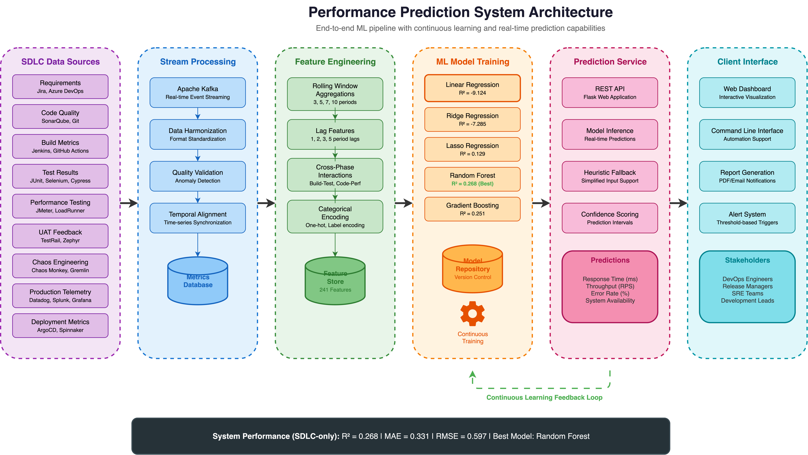
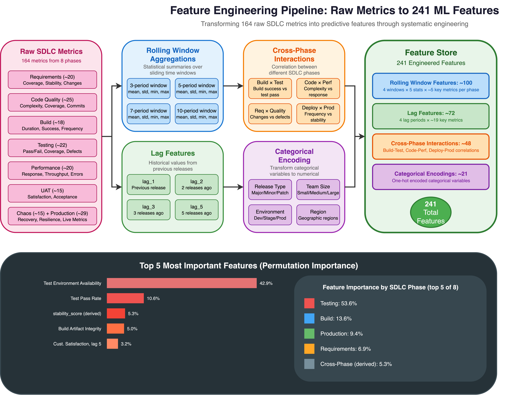
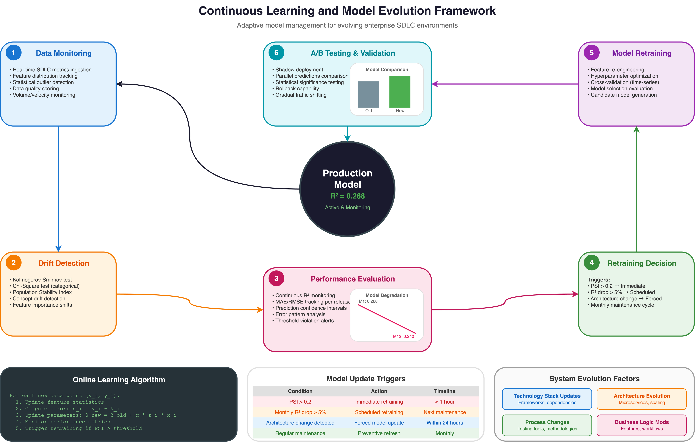
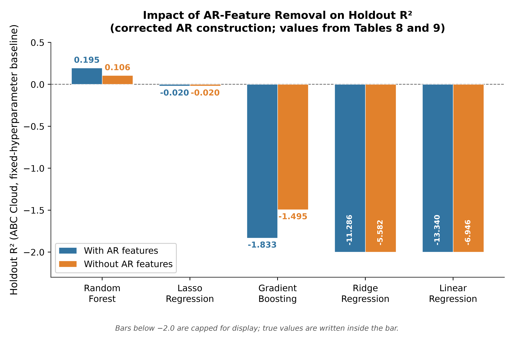
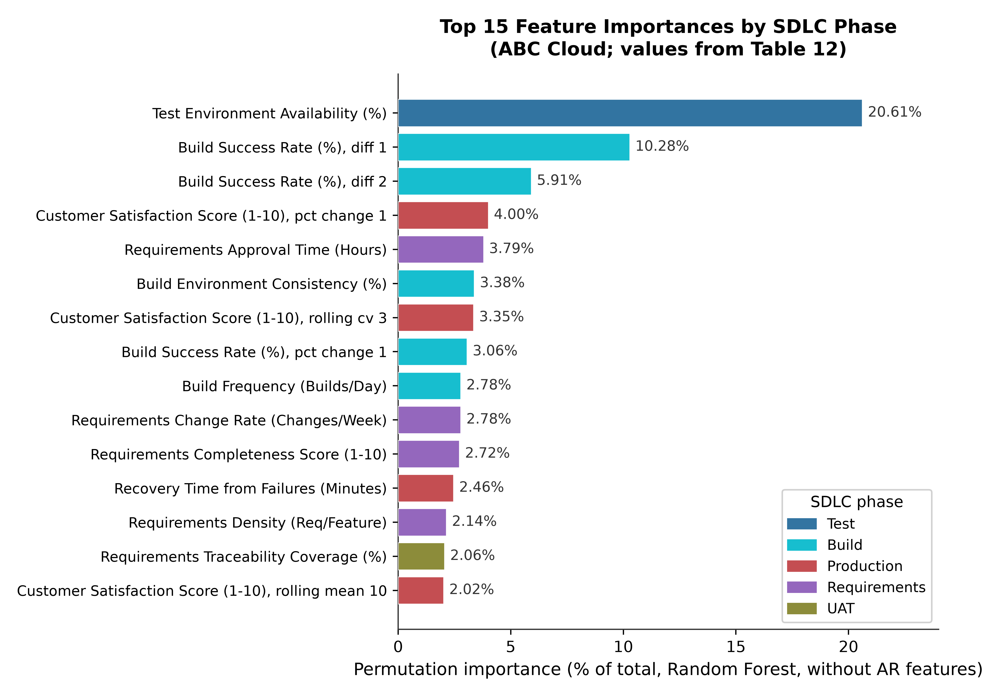
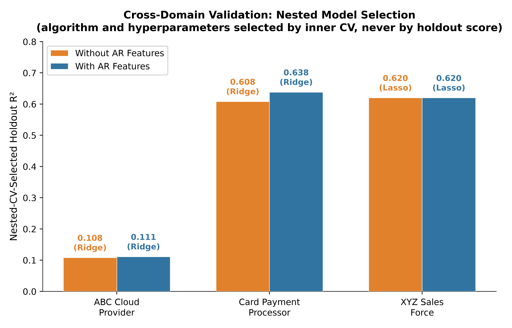
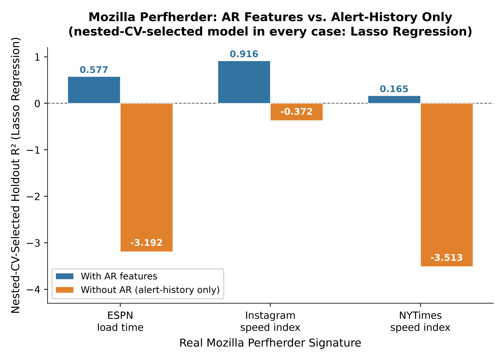
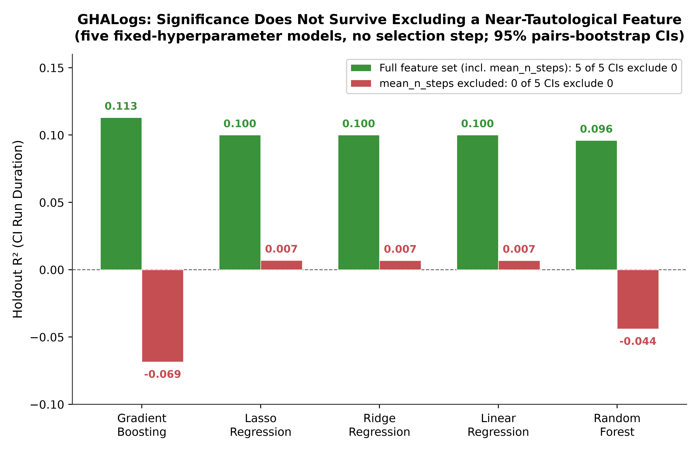

<!-- Title (set \Title{} in main_mdpi_v5.tex to match): PRESTO: A Framework for Predicting Software System Performance from SDLC Metrics (Design and Proof-of-Concept Evaluation) -->

**Abstract:** DevOps toolchains record 164 metrics across eight software development lifecycle (SDLC) phases, yet no public dataset links these pre-deployment signals to production runtime outcomes. We present PRESTO, a framework for predicting software system performance from multi-phase SDLC metrics, plus a Gaussian copula-based synthetic data generator, both evaluated as a proof of concept, not a validated prediction method. Under nested cross-validation that selects algorithm and hyperparameters within the training partition, non-autoregressive SDLC process features reach $R^2 = 0.108$ to $0.620$ across three synthetic domains; a target-correlation ablation shows this is largely recovery of the generator's specified structure, shared identically across all three domains, so the results show that the framework recovers relationships embedded in the generator. Across four real-world datasets, the primary validation analyses are Mozilla Perfherder's autoregressive persistence on a real production-performance signal ($R^2 = 0.17$ to $0.92$) and SQuaD's CVE-count ($R^2 = 0.23$) and static-analysis-enriched defect-fix ($R^2 = 0.50$) results; confidence intervals are wide throughout, and most remaining comparisons include zero. The central limitation: no available dataset joins eight-phase SDLC telemetry to production uptime, so each real dataset tests only a narrower proxy outcome (build duration, browser-performance regression, CI workflow duration, defect and CVE counts). PRESTO is therefore a framework and benchmark whose central proposition remains untested.


**Figure (graphical_abstract).** Graphical Abstract: the PRESTO framework, from 164 SDLC metrics across eight phases through feature engineering to nested-cross-validation model selection.

# Introduction {#sec:introduction}

Enterprise software teams ship code faster than ever, yet performance validation remains the slowest gate in the deployment pipeline. Traditional performance testing slows deployment pipelines because full-cycle load, stress, and endurance testing takes time delivery cannot spare. This paper's central thesis is that shift-left testing principles extend beyond functional testing to performance prediction: SDLC metrics, machine learning, and historical performance data together can forecast performance before deployment, without full-cycle testing on every change.

## Problem Context {#sec:problem_context}

As DevOps adoption accelerates and microservices replace monolithic architectures, enterprise systems generate rich telemetry across every phase of the software lifecycle, from requirements traceability through build pipeline metrics to production uptime. Performance prediction remains largely disconnected from this telemetry: most approaches rely on post-deployment monitoring or pre-release load testing, leaving the SDLC metrics pipeline untapped. This costs teams in three ways: feedback is delayed, conflicting with agile principles; full testing is impractical for every minor change, leaving deployment decisions under-informed; and teams discover SLO breaches reactively, after the blast radius has already reached customer-facing traffic, a posture that is especially costly in microservice architectures where one degraded service cascades across dependent consumers.

## Opportunity and Approach {#sec:opportunity}

Modern SDLC toolchains capture detailed metrics across eight phases: requirements analysis, code development, build processes, testing execution, performance validation, user acceptance testing, chaos engineering, and production deployment. Our analysis of enterprise-scale development projects identifies 164 distinct metrics routinely collected across these phases. This volume is what makes machine-learning performance prediction viable: by tracking SDLC patterns across releases, models can flag early indicators of potential problems before deployment, tying feedback to specific code changes rather than a downstream load test.

## Research Questions {#sec:research_questions}

Two scope conditions bound these questions. First, no real-world dataset available to this study combines full multi-phase SDLC telemetry with production uptime as its target, so PRESTO's central proposition is not tested end to end anywhere in this paper. Second, "system performance" in RQ1 therefore spans two different kinds of target: a synthetic System Uptime variable on the three copula-generated domains, and four real-world proxy outcomes (build duration, browser-performance regression, CI workflow duration, and defect/CVE counts) on the real datasets, none of which is production uptime. We accordingly present PRESTO as a framework and a proof-of-concept evaluation rather than a validated prediction method, and the four research questions below should be read in that light:

**RQ1:** To what extent can SDLC metrics predict system performance? ([Section 4.1.2](#sec:model_perf))

- *Operationalization*: We assess prediction accuracy using $R^2$, MAE, and RMSE, distinguishing SDLC-only predictive signal from temporal autocorrelation of the target variable.

**RQ2:** Which SDLC phases and metrics are most predictive of system performance? ([Section 4.1.7](#sec:feature_importance))

- *Operationalization*: We analyze feature-importance rankings and phase-level contribution percentages.

**RQ3:** How do different machine learning algorithms compare for SDLC-based performance prediction? ([Section 4.1.2](#sec:model_perf) and [Section 4.1.3](#sec:model_char))

- *Operationalization*: We evaluate five algorithms (Linear Regression, Ridge, Lasso, Random Forest, Gradient Boosting) under both a fixed-hyperparameter baseline and a nested cross-validation protocol that tunes every algorithm equivalently.

**RQ4:** What factors influence the accuracy of SDLC-based performance predictions? ([Section 4.1.9](#sec:rq4_factors))

- *Operationalization*: We examine temporal dependencies, cross-phase interactions, release characteristics, and system-evolution impacts.

## Contributions {#sec:contributions}

We propose PRESTO (Performance REgression from Software development Telemetry and Operations), a performance prediction framework driven by multi-phase SDLC metrics, evaluated on three synthetic enterprise domains (a five-year cloud platform, 170 releases; a CRM/SaaS system, 200 releases; a payment processor, 150 releases) and four independent real-world datasets. Cross-domain results appear in [Section 4.1.10](#sec:cross_domain).

Our contributions:

1.  **Operationalizing PRESTO**, a unified SDLC metric collection and standardization framework enabling full-lifecycle analysis that integrates development process indicators with performance prediction.

2.  **Shifting prediction left**: using 241 features engineered from pre-deployment SDLC metrics (test pass rates, build stability, requirements traceability) to predict a production-uptime target before deployment, which would provide risk signals earlier than canary deployments can surface them. The qualifier matters: the uptime target is realized only in this paper's three synthetic domains. No real-world dataset available to us pairs pre-deployment SDLC features with a production-uptime outcome, so this contribution is a framework design demonstrated on synthetic data, not a capability validated on production systems.

3.  **A reproducible Gaussian copula-based synthetic data generator** producing 164 SDLC metrics across eight phases, calibrated to DORA 2024 benchmarks, released as a public benchmark. Cross-domain consistency in this generator's output reflects a single shared correlation specification applied under three different marginal/temporal configurations, not three independent confirmations of the same finding ([Section 5.1](#sec:internal_validity)).

4.  **Establishing transparent baselines under a nested-cross-validation model-selection protocol** ([Section 4.1.2](#sec:model_perf); [Section 3.2.5](#sec:nested_cv_protocol)): the nested-CV-selected without-AR model achieves $R^2 = 0.108$ to $0.620$ across the three enterprise domains, beating naive baselines on the reference domain; the wide bootstrap intervals reported alongside are untuned-baseline intervals on fixed-hyperparameter Random Forest ([Section 4.1.5](#sec:bootstrap_ablation)) and do not cover these nested-CV-selected figures.

5.  **Quantifying autoregressive-feature dependence in SDLC performance prediction** ([Section 4.1.2](#sec:model_perf)): an algebraic-recoverability audit identifies a same-row leakage mode in two of the four AR feature families ([Section 3.1.3](#sec:temporal_alignment)); under that leaky construction, approximately 88% of the with-AR gain appears attributable to autoregressive persistence, an artifact of the leakage rather than genuine persistence ([Section 5.1](#sec:internal_validity)). Under the corrected construction the picture is domain-specific: the reference domain's with-AR advantage all but disappears (its bootstrap CI includes zero, exactly like the without-AR result), and only one of three domains (XYZ Sales Force) has a with-AR result whose own bootstrap CI excludes zero under fixed hyperparameters; even there, a paired-difference test cannot distinguish that result from the same domain's without-AR result ([Section 4.3](#sec:paired_diff)), and a fairly regularized nested-CV-selected model does not use the AR features at all.

6.  **Identifying that testing and build infrastructure metrics** ([Section 4.1.7](#sec:feature_importance)) are the strongest SDLC predictors of production performance in this synthetic design (Build-phase 32.1%, Test-phase 21.1%, versus Code-phase 4.9%), a hypothesis the real-world TravisTorrent validation corroborates only weakly and only in feature-ranking direction, not in predictive strength, once a definitionally circular feature is excluded ([Section 4.2.1](#sec:travistorrent)).

7.  **Proposing a continuous learning framework** with drift detection (PSI, KS tests) and automated retraining triggers. This framework is an architectural proposal only; as [Section 3.2.6](#sec:continuous_learning) and Figure 3 note, it has not been experimentally validated, and we do not claim it is ready for production deployment as it stands.

8.  **Proposing PA-RFE (Phase-Aware Recursive Feature Elimination)** (Algorithm [\[alg:parfe\]](#alg:parfe), [Section 4.1.8](#sec:parfe_results)), which guarantees cross-phase feature representation: a structural, mechanical property that holds on all three domains under both validation-based and nested-CV stopping-point selection. Its test-set predictive accuracy does not reliably exceed simpler feature-selection baselines, and under nested selection it varies in direction across the three domains ([Section 4.1.8](#sec:parfe_results)). We do not claim PA-RFE delivers a general predictive advantage; the phase-coverage guarantee is the contribution.

9.  **Evaluating on four independent real-world datasets** ([Section 4.2](#sec:real_world_results)) of deliberately different shapes: TravisTorrent (within-project temporal), Mozilla Perfherder (within-signature temporal, genuine AR persistence), GHALogs (cross-sectional, with a full-feature result carried largely by a near-tautological feature, [Section 4.2.3](#sec:ghalogs)), and SQuaD (cross-sectional, defect and vulnerability prediction). This precisely scopes what each dataset does and does not confirm about PRESTO's central proposition, rather than treating any one of them as a full validation of multi-phase SDLC metrics predicting production uptime.

## Paper Organization {#sec:organization}

[Section 2](#sec:related_work) reviews related work. [Section 3](#sec:methodology) covers methodology, including the nested cross-validation protocol and the per-dataset split construction. [Section 4](#sec:results) presents results. [Section 5](#sec:threats) addresses threats to validity. [Section 6](#sec:discussion) discusses practical implications and future work. [Section 7](#sec:conclusions) concludes. [Section 8](#sec:supplementary) holds supplementary material: generator calibration verification and defect analysis, secondary robustness diagnostics, and extended glossary entries, kept out of the main body so the paper stays focused on its research questions, methodology, main analyses, and conclusions; a separate accompanying Supplementary Materials file holds the per-family paired-difference interpretation and the full secondary robustness diagnostics.

# Related Work {#sec:related_work}

Software performance prediction has progressed through three eras, each solving a different bottleneck: queuing theory for static architectures (1980s to 1990s), component-level modeling for design-time prediction (2000s), and machine learning for configuration optimization (2010s). None of these approaches use SDLC process metrics as predictive inputs. We organize prior work into seven areas and identify the gap PRESTO targets.

## Traditional Performance Modeling and Prediction {#sec:rw_traditional}

Software performance prediction originated with queuing network models [@lazowska1984; @reiser1980] and foundational evaluation methodologies [@ferrari1978; @sauer1981; @jain1991]. Smith [@smith1990] established Software Performance Engineering (SPE) as a discipline focused on early lifecycle performance considerations, later demonstrating practical applications with object-oriented methodologies [@smith2002]. Balsamo et al. [@balsamo2004] and Cortellessa et al. [@cortellessa2011] surveyed model-based prediction approaches, while Jiang and Hassan [@jiang2015] addressed load testing scalability challenges. Performance regression detection methods include statistical process control [@nguyen2012], automated repository analysis [@foo2010], and early distributed application prediction [@hplabs2006]. Weyuker and Vokolos [@weyuker2000] established practical testing methodologies for industrial systems.

## Design-Level and Component-Based Performance Prediction {#sec:rw_component}

Component-based performance prediction emerged through Liu et al. [@liu2005] for design-level analysis and Pooley and King [@pooley1999] for UML integration. Menasce et al. [@menasce2004] advanced capacity planning methodologies, while Kant [@kant1992] addressed internet application challenges. Woodside et al. [@woodside2007] developed layered queuing networks for multi-tier systems, Koziolek [@koziolek2010] surveyed component-based evaluation methods, and Becker et al. [@becker2009] introduced the Palladio Component Model (PCM) for model-driven prediction. Jin et al. [@jin2014] and Chen et al. [@chen2009] examined configuration effects on testing and variability management, respectively.

## Software Metrics and Quality Prediction {#sec:rw_metrics}

Software metrics research established foundations for using process indicators as quality predictors, from the Chidamber-Kemerer OO metrics suite [@chidamber1994] and McCabe's cyclomatic complexity [@mccabe1976] to COCOMO II [@boehm2000] for cost estimation. Fault prediction evolved through historical defect patterns [@ostrand2002], complexity-defect correlations at Microsoft [@nagappan2006], classification benchmarks [@lessmann2008], and just-in-time quality assurance [@kamei2013]. Related work on code smell longevity [@arcoverde2011] and technical debt [@li2015] provides context for understanding how code quality indicators evolve. A recent business-driven systematic mapping study of industrial ML defect-prediction practice [@stradowski2023business] reaches a conclusion consonant with this paper's own emphasis on practical, decision-relevant framing over raw accuracy: predictive power alone rarely drives industrial adoption without a clear link to business cost and process context. While these studies demonstrate the predictive value of development metrics for quality attributes, performance prediction has remained largely outside their scope.

## DevOps and Continuous Integration Metrics {#sec:rw_devops}

The DORA metrics framework [@forsgren2018] established four key delivery performance indicators; the 2024 report [@dora2024] confirms elite teams achieve 127$\times$ faster lead times. CI metrics research has explored adoption patterns [@hilton2016], quality improvements [@vasilescu2015], CI feature usage [@gallaba2020], build duration [@ghaleb2019], test-build relationships [@beller2017], deep learning for build failure prediction [@saidani2022], DevOps adoption [@riungu2016], metrics reviews [@devopsmetrics2024], performance-oriented DevOps [@brunnert2015], and parallel CI acceleration [@parallelci2023]. Existing research primarily applies these metrics to deployment success, delivery velocity, and defect detection rather than runtime performance forecasting.

## Issue-Handling Processes and Project-Actor Cooperation {#sec:rw_issue_handling}

None of the metric families surveyed above capture a distinct source of process signal: how a project's actors (developers, maintainers, reviewers, and reporters) cooperate and exchange information while resolving issues, and how that cooperation pattern shifts as a project encounters unexpected problems. This literature typically represents issue-handling activity as a graph over tracker events (assignments, comment threads, reopens, cross-issue references) rather than as the throughput counts (ticket volume, mean time to triage) PRESTO's Requirements and Production phases currently capture. Graph-driven analysis of issue-handling schemes [@issuehandling2024] shows that structural properties of this cooperation graph (actor centrality, information-exchange latency between the events that make up an issue's lifecycle, and the shape of reopen/escalation subgraphs) carry signal about project health distinct from simple ticket counts, extending a broader line of work on issue-reopen rates and triage time as reliability indicators [@ostrand2002].

This connects directly to two limitations this paper acknowledges ([Section 6.3](#sec:limitations)): PRESTO's current 164-metric registry omits issue-tracking process signals and does not model project-actor cooperation at all. A ninth, cross-cutting metric family (an "Issue-Handling Graph" phase, alongside PRESTO's existing eight lifecycle phases) would add graph-derived features (actor-cooperation density, information-exchange latency, reopen/escalation subgraph patterns) computed from issue-tracker event logs; the same rolling-window and lag feature-engineering pipeline already used throughout this paper ([Section 3.1.3](#sec:temporal_alignment)) would apply to these features unchanged, since they would be release-aggregated time series like every other PRESTO metric. This is a proposed extension, not one this paper implements or evaluates: none of the four real-world datasets used here ([Section 4.2](#sec:real_world_results)) provide issue-tracker event logs at the granularity a cooperation graph requires, and adding this family without evaluating it would repeat the kind of unvalidated-but-asserted claim this paper otherwise avoids (compare Contributions item 7's continuous-learning framework, similarly flagged as architectural-only). We return to this in [Section 6.4](#sec:future_work).

## Machine Learning in Software Engineering {#sec:rw_ml}

ML adoption in software engineering is well-established for defect prediction [@menzies2007; @hall2012], with surveys identifying performance prediction as under-explored [@zhang2019; @allamanis2018]. Performance-related ML work includes build outcome prediction [@chen2020buildfast], the detection and prevention of temporal data leakage in build prediction [@mishra2026leakage] (a companion paper by two of the present authors that develops and validates a general taxonomy of temporal-leakage failure modes in ML-based build prediction; PRESTO applies that taxonomy's shift-fix methodology to a different task and contributes a further, previously uncatalogued leakage mode specific to this setting: the target-derived difference/percentage-change same-row leakage documented in [Section 3.1.3](#sec:temporal_alignment)), change-induced incident analysis [@wu2023incidents], and memory-pattern-based detection [@nistor2013]. For configurable systems, approaches range from performance-influence models [@siegmund2015] and deep sparse networks (DeepPerf) [@ha2019] to sequential optimization (FLASH) [@nair2020], data-efficient learning [@guo2018], and transfer learning [@jamshidi2017; @jamshidi2018]. Additional work addresses Spark performance [@sparkml2019], validation methodology [@tantithamthavorn2016], early regression detection [@earlydetection2024], continuous prediction [@pace2023], ML in DevOps [@mldevops2022], ML-SDLC integration [@mlsdlc2024], reliability prediction [@reliability2025], and microservice fault localization [@zhou2019]. AIOps and MLOps have accelerated operational ML adoption [@dang2019; @notaro2021; @diazdearcaya2024]. The integration of SDLC process metrics with performance prediction remains a gap.

## Research Gaps and Contributions {#sec:rw_gaps}

The review of existing literature reveals three gaps our research addresses: an **Integration Gap** (traditional performance prediction relies on design models, historical performance data, or experience-based forecasting, missing the development process metrics contemporary toolchains provide); a **Scope Gap** (existing SDLC metrics research focuses on quality and effort prediction rather than runtime performance forecasting); and a **Coverage Gap** (ML applications in software engineering have not used the multi-phase metric collection capabilities modern toolchains provide, including the issue-handling cooperation signals discussed in [Section 2.5](#sec:rw_issue_handling)).

Table `related_work` positions PRESTO relative to the most relevant prior approaches.

| **Approach** | **Input Data** | **Target** | **Method** | **Validation** | **Best Result** | **Key Limitation** |
|---|---|---|---|---|---|---|
| DeepPerf [@ha2019] | Config. options | Response time | Deep NN | 10 real systems | MAPE 1 to 5% | Config space only, no process metrics |
| Siegmund [@siegmund2015] | Config. options | Runtime perf. | Perf.-influence models | Real systems | Varied | Requires sampling of config. space |
| Nair FLASH [@nair2020] | Config. samples | Perf. metric | Sequential model-based | Real systems | Faster than DeepPerf | Config optimization, not prediction |
| DORA [@forsgren2018] | Delivery metrics | Delivery perf. | Survey/regression | 31K+ professionals | Correlational | Aggregate team metrics, no ML |
| Palladio [@becker2009] | Architecture model | Response time | Analytical/sim. | Case studies | Accurate for components | Manual modeling, design-time only |
| Defect Pred. [@menzies2007] | Code metrics | Defects | Tree learners | Open source | Recall 71% | Not performance-focused |
| **PRESTO (ours)** | **8-phase SDLC metrics** | **System uptime (synthetic target only); build duration, browser-perf. regression, CI run duration, defect/CVE counts (real proxy outcomes)** | **Ensemble ML, nested CV** | **3 synthetic domains (uptime target); 4 real datasets (proxy outcomes, no uptime)** | **$R^2$ = 0.11 to 0.62** (nested-CV-selected, synthetic) | **Proof-of-concept; no real-uptime validation** |

As the table shows, prior performance prediction methods operate on configuration spaces (DeepPerf, Siegmund, FLASH), architectural models (Palladio), or aggregate delivery metrics (DORA). None use the fine-grained, multi-phase SDLC process metrics that modern CI/CD toolchains generate. Each study also measures and validates its own target differently: DeepPerf and Siegmund's runtime-performance figures come from benchmarking the configured system directly; FLASH measures its performance metric the same way, through direct configuration sampling; DORA's delivery-performance figures come from a 31,000-respondent self-report survey rather than direct instrumentation; Palladio's response-time predictions are validated against measured response times in case-study systems; and the defect-prediction baseline's target is a binary defect label taken from issue-tracker and version-control history. PRESTO's own target, System Uptime, is defined and measured as described in [Section 3.2.4](#sec:exp_setup_validation).

# Materials and Methods {#sec:methodology}

This section presents the PRESTO framework methodology, covering data intake, feature engineering, model architecture, and validation strategy, including the nested cross-validation protocol.

## Data Intake Pipeline {#sec:data_intake}

### Multi-Source Data Ingestion Challenges {#sec:ingestion_challenges}

PRESTO ingests SDLC metrics from disparate source systems (issue trackers, version-control platforms, CI/CD servers, test frameworks, monitoring tools), each with its own schema, sampling cadence, and identifier scheme. Reconciling 164 metrics across eight phases into one release-aligned table requires resolving inconsistent release identifiers across systems, handling systems that report on different cadences (per-commit vs. per-deployment vs. daily), and tolerating instrumentation gaps that differ by phase and by organization.

### Data Harmonization and Standardization {#sec:harmonization}

Before any normalization happens, each of the 164 metrics has to come from somewhere. In a real deployment of PRESTO, the eight phases draw from different source systems, and Table `metric_sources` gives representative examples of how each phase's metrics would actually be extracted, rather than leaving that step implicit.

| **SDLC Phase** | **Representative Metric** | **Source System** | **Extraction Method** |
|---|---|---|---|
| Requirements | Requirements stability index | Jira, Azure DevOps | Count of requirement field changes after sprint start, divided by total requirements, pulled via the issue tracker's REST API or changelog export |
| Code | Cyclomatic complexity, code coverage | GitHub, GitLab, SonarQube | Static-analysis tool output (SonarQube, PMD) attached to each commit or pull request, joined to the repository's commit history via the version-control API |
| Build | Build success rate, build duration | Jenkins, GitHub Actions, CircleCI | CI server build logs and job metadata, exported through the CI system's API or webhook events |
| Test | Test pass rate, test coverage | JUnit, pytest, GitHub Actions test reports | Parsed test-runner XML or JSON reports (for example JUnit XML) attached to each CI run |
| Performance Testing | Response time, throughput | JMeter, Gatling, k6 | Load-test tool output logs, typically exported as CSV or JSON summary reports per test run |
| UAT | User satisfaction score, acceptance rate | Survey tools, UAT tracking sheets, Jira | Structured UAT sign-off records, either a dedicated UAT tracker or a Jira issue type with acceptance fields |
| Chaos Engineering | Recovery time, resilience score | Chaos Monkey, Gremlin, custom fault-injection harnesses | Chaos-experiment run logs recording time-to-detect and time-to-recover for each injected fault |
| Production | Uptime, error rate | APM tools (Datadog, New Relic), status-page aggregators | Monitoring-platform API queries or exported incident and availability reports, aggregated per release window |

This paper's own three synthetic domains do not go through this extraction pipeline. Because no organization publicly releases the raw Jira, GitHub, CI, and monitoring exports needed to build a real SDLC-to-performance dataset ([Section 3.1.4](#sec:synthetic_data) explains why), the synthetic generator produces already-harmonized metric values directly from calibrated distributions, skipping the extraction step described above.

Converting 164 distinct metrics into consistent ML features requires per-metric normalization strategies: logarithmic scaling for heavy-tailed metrics ($x_{\text{normalized}} = \log(x+1)/\log(x_{\max}+1)$), standardization for bounded-distribution metrics ($x_{\text{normalized}} = (x-\mu_x)/\sigma_x$), and one-hot, target, or ordinal encoding depending on categorical cardinality and structure.

### Temporal Alignment and Feature Engineering {#sec:temporal_alignment}

SDLC metrics have complex temporal relationships that must be preserved during feature engineering. Code metrics measured at commit-level granularity must align with build metrics captured per deployment cycle, which in turn must synchronize with test metrics generated during release validation. Release is the main temporal unit; commit-level metrics are aggregated to release level, performance outcomes are aligned to the corresponding release window, and missing values are forward-filled for time-series continuity.

Feature engineering transforms raw metrics into predictive signals through rolling-window aggregations (moving averages, standard deviations, minima, maxima, and coefficients of variation across 3, 5, 7, and 10 period windows), lag features (values from 1, 2, 3, and 5 previous releases), trend derivatives (rate-of-change calculations), and cross-phase interaction terms.

**Two same-row leakage modes and their correction.** In the rolling-window computation (`add_rolling_features()`), statistics computed inclusive of the current row, rather than over strictly-prior releases, leak the current target into its own predictors; the pipeline therefore shifts each series by one period before computing any rolling statistic.

A second mode arises in the lag features. To reconcile a weak raw autocorrelation in the target variable with a large apparent benefit from autoregressive (AR) features, we audit every AR-derived feature for algebraic recoverability of the current-row target, the same check applied to Mozilla Perfherder's adapter ([Section 4.2.2](#sec:perfherder)) and to TravisTorrent's `tr_log_testduration` ([Section 4.2.1](#sec:travistorrent)). The audit identifies a construction defect in `add_lag_features()`: for the target column specifically, `diff_k` and `pct_change_k` were computed against the current, unshifted row (`df_out[metric] - df_out[metric].shift(k)`), rather than a prior-shifted one; only `lag_k` was genuinely prior-period. Across all three synthetic domains and all four lag steps, `target_t = lag_k + diff_k` and `target_t = lag_k \cdot (1 + \text{pct\_change}_k)` hold exactly in 97% to 99% of rows (the only exceptions are the handful of NaN leading rows each lag step introduces). Under this leaky construction, 8 of the 32 AR features (the target's own `diff_k` and `pct_change_k` across four lag steps) let a model algebraically reconstruct the current-row target rather than predict it, contrary to the assumption that all 12 lag/diff/pct-change features were correctly shifted.

The corrected construction mirrors the rolling-window shift: `add_lag_features()` computes the target's own `diff_k` and `pct_change_k` against a series shifted by one period first, so every target-derived AR feature at row $t$ describes strictly-prior releases only. The correction is scoped to the target column specifically; for the three non-target metrics in the same feature family (Build Success Rate, Customer Satisfaction Score, Throughput), the current row's own value is a legitimate contemporaneous feature, already used directly elsewhere in the feature set, so an unshifted `diff_k`/`pct_change_k` for those metrics is not a leakage problem and is left unchanged. We verified the scoping: the without-AR feature matrix is byte-identical under the leaky and corrected constructions (confirmed via hash comparison), since without-AR results exclude the target-derived AR columns entirely regardless of how they were computed.

The effect on with-AR results is large: on the reference domain, the with-AR Random Forest holdout $R^2$ is 0.914 under the leaky construction and approximately 0.11 to 0.19 under the corrected one, with a bootstrap confidence interval that includes zero. [Section 5.1](#sec:internal_validity) gives the full disclosure, and every with-AR result in this paper uses the corrected construction.

### Synthetic Data Generation Methodology {#sec:synthetic_data}

No public dataset combines SDLC process metrics with correlated runtime system performance measurements. We confirmed this through an exhaustive search of major ML data repositories (UCI Machine Learning Repository, Kaggle, Zenodo, Papers with Code Datasets) and software engineering benchmarks (TravisTorrent [@beller2017travistorrent], GHTorrent, PROMISE repository). This absence of public benchmarks is itself a contribution gap that our synthetic generator addresses, providing the first reproducible dataset for this prediction task.

The core idea is simple even though the implementation has several moving parts: pick realistic distributions for each of the 164 metrics individually, then wire in the correlations we believe should hold between them, and finally layer on realistic time dynamics so consecutive releases are not independent draws. [Section 5.1](#sec:internal_validity) discusses candidly what this approach can and cannot demonstrate. The generator employs a four-stage pipeline: (1) marginal-distribution specification, calibrated against the DORA 2024 State of DevOps report [@dora2024] and published enterprise project statistics [@forsgren2018]; (2) a Gaussian-copula correlation structure [@nelsen2006] over 84 specified non-zero pairs, with the correlation matrix ensured positive semi-definite via Higham's alternating-projections algorithm [@higham2002] and the prediction target generated as a copula-correlated metric with its own marginal distribution rather than a deterministic function of the features, so the model must discover latent correlations rather than recover a known function; (3) temporal dynamics (AR(1) rank-preserving autoregression, a maturity trend, release-type effects, and stochastic shock events); and (4) statistical validation against the generator's own specifications.

**Metric Registry (Representative Excerpt).** Table `metric_registry` gives a representative excerpt of the full 164-metric registry (`src/metric_registry.py` in the released code), spanning the distribution families used across all eight phases; the complete registry, including every metric's definition, distribution, and parameters, is in the reproducibility package rather than reproduced in full here.

| **Metric** | **SDLC Phase** | **Distribution** | **Key Parameters** | **Bounds** |
|---|---|---|---|---|
| System Uptime (%) [target] | Production | Beta | a=15, b=1.0 (base); domain-specific override per Table `domain_overrides` | [85, 100] base |
| Mean Time to Recovery (MTTR) (Minutes) | Production | Lognormal | mu=2.8, sigma=0.7 | [0, 120] |
| Build Success Rate (%) | Build | Beta | a=5.0, b=1.3 | [50, 100] |
| Cyclomatic Complexity | Code | Lognormal | mu=2.5, sigma=0.5 | [1, 50] |
| Unit Test Coverage (%) | Test | Beta | a=6.0, b=1.2 | [60, 100] |
| Response Time (ms) | Performance Test | Lognormal | mu=5.1, sigma=0.6 | [1, 1000] |
| Requirements Coverage (%) | Requirements | Beta | a=8.0, b=1.0 | [75, 100] |
| User Satisfaction Score (1 to 10) | UAT | Truncated Normal | mu=8.1, sigma=1.3 | [1, 10] |

Table `domain_overrides` gives the domain-specific System Uptime overrides, as applied by the corrected generator (defect analysis below).

| **Domain** | **Distribution** | **Parameters** | **Bounds** |
|---|---|---|---|
| ABC Cloud Provider | Beta | a=15, b=1.2, loc=92, scale=8 | [92, 100] |
| Card Payment Processor | Beta | a=12, b=1.2, loc=90, scale=10 | [90, 100] |
| XYZ Sales Force | Beta | a=10, b=1.5, loc=88, scale=12 | [88, 100] |

**Generator calibration defects.** An audit of the generator code against its documentation identifies three implementation defects: 48 of 84 documented correlation pairs were silently discarded by an iteration-logic error (only 36 ever reached the copula); a per-domain distribution override for System Uptime was documented but never applied by any code path; and two metrics documented as negative-binomial counts were silently sampled from a continuously-valued Gamma distribution instead, never rounded to integers. We corrected all three, regenerated all three synthetic domains, and reran the full downstream pipeline; every synthetic-domain number in this paper reflects the corrected generator. Full detail (the exact code paths, the metadata verifying the fix, and the before/after correlation-matrix distance and goodness-of-fit figures) is in [Section 8.1](#sec:supp_generator_bugs) rather than reproduced here.

One related issue was identified and deliberately left unfixed: System Uptime's realized lag-1 autocorrelation remains far below its specified target (0.031 vs. a specified 0.55 to 0.65) because its distribution is heavily right-skewed toward the upper bound (roughly 82% of releases pin at the ceiling after bounds enforcement), leaving the rank-based AR(1) transform little room to express persistence for this specific variable. This is a structural property of pairing a ceiling-concentrated marginal with a rank-based AR(1) transform applied before bounds clipping, not an implementation defect; we did not redesign the target's marginal distribution or the temporal-generation procedure to force a higher realized ACF, since doing so in direct response to this observation would be exactly the kind of results-contingent design choice [Section 5.1](#sec:internal_validity) already flags as a threat when discussing the copula's hand-specified correlations elsewhere. All 163 other metrics recover their specified AR(1) structure within tolerance; this is an acknowledged limitation of the target variable's temporal realism specifically, discussed further alongside the AR-feature audit in [Section 5.1](#sec:internal_validity).

**Domain Profiles.** Three domain-specific configurations: **ABC Cloud Provider** (170 releases over 5 years, 200+ microservices, DORA "High" tier, reference dataset), **XYZ Sales Force** (200 releases over 5.5 years, aggressive release cadence, DORA "High" tier), and **Card Payment Processor** (150 releases over 4 years, ~one release every 9.7 days, PCI-DSS compliance, DORA "High" tier).

**Reproducibility.** All generation parameters are published as YAML configuration files; the generator is deterministic given a fixed seed. The complete generator code and configuration are archived at Zenodo (DOI: 10.5281/zenodo.22005439).

**Limitations of Synthetic Data:** cannot capture emergent phenomena in real distributed systems; copula-specified correlations may be simpler than real-world dependencies; temporal dynamics are parametric approximations of complex organizational processes; real-world validation with production SDLC data remains essential future work.

### Data Quality and Anomaly Detection {#sec:data_quality}

The pipeline implements range validation, statistical outlier detection (z-score thresholds), cross-metric consistency checks, and missing-value handling (forward-fill for time series, mean imputation for cross-sectional data).

## Proposed Approach and Models {#sec:approach_models}

PRESTO employs a multi-layered architecture that transforms heterogeneous SDLC metrics into performance forecasts. [Figure 1](#fig:system_arch) presents the complete system workflow across five architectural tiers.



**Figure (system_arch).** PRESTO System Architecture. Proposed end-to-end pipeline from SDLC metric sources through feature engineering and ML model training to prediction output.

### Feature Engineering Pipeline {#sec:feature_eng_pipeline}

Figure 2 summarizes the six-stage pipeline detailed below.



**Figure (feature_pipeline).** PRESTO Feature Engineering Pipeline. Six-stage transformation from raw SDLC metrics to a reduced feature set via PA-RFE (241 SDLC features before reduction, 273 including autoregressive temporal features).

The pipeline generates candidate features in five stages, applies variance-based filtering, then performs phase-aware dimensionality reduction (Stage 6): (1) rolling-window aggregations across four window sizes with five statistics each; (2) lag features from 1, 2, 3, and 5 previous releases; (3) multiplicative cross-phase interaction terms; (4) categorical encodings; (5) removal of near-zero-variance or highly collinear ($r > 0.95$) features, leaving **273 features**, of which 241 are SDLC process features and 32 are autoregressive (AR) temporal features, analyzed separately in [Section 4.1.11](#sec:leakage); and (6) Phase-Aware Recursive Feature Elimination (PA-RFE) on the 241 SDLC features.

**Stage 6: Phase-Aware Feature Selection (PA-RFE).** Unlike standard RFE [@guyon2002], which eliminates features globally by importance and can remove entire SDLC phases, PA-RFE enforces a *phase-balance constraint*: each of the eight SDLC phases retains at least $k_{\min}$ features throughout elimination ($k_{\min} = 2$). Algorithm [\[alg:parfe\]](#alg:parfe) presents the procedure. Selecting the feature subset by maximizing *validation*-set $R^2$ across a single fixed 60/20/20 temporal split overfits severely on the reference domain (validation $R^2=0.271$ vs. test $R^2=-3.026$), so PA-RFE's stopping point is instead selected under the nested cross-validation protocol described in [Section 3.2.5](#sec:nested_cv_protocol): the stopping point is chosen by mean inner-CV $R^2$ across 2 inner temporal folds within the 80% outer-training partition, never by a single validation split, and the resulting feature subset is scored once on the untouched 20% outer holdout. Results are in [Section 4.1.8](#sec:parfe_results).

Before the pseudocode, here is what each symbol means. $X$ is the feature matrix ($n$ rows, $p$ columns), $y$ the target vector. $\phi$ maps each feature name to its SDLC phase. $k_{\min}$ is the minimum features PA-RFE must keep per phase; $s$ is the step size (features removed per iteration). $F$ is the current working feature set; $C$ is the ablation curve, a running log of $(|F|, R^2)$ pairs. $\pi$ is the permutation-importance vector for features in $F$. $E$ is the current iteration's elimination batch. $F^*$ is the final answer: whichever $F$ in $C$ scored best by the selection criterion in force (mean inner-CV $R^2$ under the nested protocol; validation $R^2$ on a fixed split for the comparison in Table `parfe_nested`).

```
Algorithm: Phase-Aware Recursive Feature Elimination (PA-RFE)
Require: Feature matrix X in R^(n x p), target y,
         phase map phi: feature -> phase,
         min per phase k_min, step size s
Ensure:  Optimal feature subset F*, ablation curve C

F <- {f_1, ..., f_p}; C <- []
while |F| > k_min * |phases| do
    Train model M on X_train[F]
    pi <- PermutationImportance(M, X_val[F])
    Record (|F|, R^2_val) in C
    Sort F by pi ascending (least important first)
    E <- {}                                  // elimination batch
    for f in sorted F do
        if |E| >= s then
            break
        if |{g in F \ E : phi(g) = phi(f)}| > k_min then
            E <- E union {f}
    if E = {} then
        break                                 // no features removable
    F <- F \ E
F* <- argmax_{(|F|, R^2) in C} R^2
return F*, C
```

**Algorithm (PA-RFE).** Phase-Aware Recursive Feature Elimination.

Each feature is mapped to its SDLC phase via the metric registry; derived features inherit the phase of their parent metric. Computational complexity is $O(K \cdot n \cdot p \cdot r)$ where $K$ is iterations ($\sim 45$), $n$ samples, $p$ current features, and $r$ permutation repeats.

### Machine Learning Model Architecture {#sec:ml_architecture}

The prediction system evaluates five regression algorithms selected to span the complexity spectrum: Linear Regression (interpretable baseline), Ridge Regression (L2 regularization, appropriate given correlated SDLC metrics), Lasso Regression (L1 regularization, implicit feature selection), Random Forest [@breiman2001] (bagged decorrelated trees, handles high-dimensional correlated features via random subspace selection), and Gradient Boosting [@friedman2001] (sequential additive ensemble, captures cross-phase interactions without explicit interaction terms).

### Hyperparameter Specifications {#sec:hyperparams}

Table `hyperparams` reports the fixed hyperparameter configuration used for this paper's *fixed-hyperparameter baseline* results (Sections [4.1.2](#sec:model_perf) to [4.1.9](#sec:rq4_factors) unless otherwise noted); [Section 3.2.5](#sec:nested_cv_protocol) describes the nested-cross-validation protocol that tunes every algorithm's hyperparameters, and, where the two disagree, this paper reports the nested-CV-selected result as the main result (per the Model-Selection Rule, [Section 3.2.4](#sec:exp_setup_validation)) while retaining the fixed-hyperparameter tables as an explicit baseline comparison.

| **Algorithm** | **Parameter** | **Value** | **Method** |
|---|---|---|---|
| Ridge | alpha | 1.0 | Default |
| Lasso | alpha | 1.0 | Default |
| Random Forest | n_estimators | 100 | Fixed |
| Random Forest | max_depth | 10 | Fixed |
| Random Forest | min_samples_split | 5 | Fixed |
| Random Forest | min_samples_leaf | 2 | Fixed |
| Gradient Boost | n_estimators | 100 | Fixed |
| Gradient Boost | max_depth | 6 | Fixed |
| Gradient Boost | learning_rate | 0.1 | Fixed |
| Gradient Boost | min_samples_split | 5 | Fixed |
| All models | random_state | 42 | Fixed |
| All models | StandardScaler | fit on train only | not applicable |

### Experimental Setup and Validation Strategy {#sec:exp_setup_validation}

**Dataset Characteristics:** Reference dataset (ABC Cloud Provider): 170 releases, 5 years, 200+ microservices. Further domains: XYZ Sales Force, 200 releases, 5.5 years; Card Payment Processor, 150 releases, 4 years. Feature space: 273 engineered features (241 without AR features) from 8 SDLC phases. Target variable: System Uptime (%); in a live deployment this would be computed per release window as $(1 - \text{downtime minutes}/\text{total minutes}) \times 100$ over a 30-day post-release window, sourced from whatever monitoring platform the organization runs. In this study's synthetic domains, System Uptime is instead drawn directly from a calibrated marginal distribution inside the copula generator ([Section 3.1.4](#sec:synthetic_data)).

**Validation Protocol:** Because PRESTO forecasts performance from pre-deployment signals, respecting chronological order is essential to avoid temporal data leakage, a failure mode characterized for build prediction in prior work [@mishra2026leakage]. We employ 5-fold expanding-window time-series cross-validation (`TimeSeriesSplit(n_splits=5)`) on the 80% training partition. Final holdout evaluation uses the remaining 20% (the most recent releases), never seen during training or, under the nested protocol described next, during model or hyperparameter selection either.

**Per-Dataset Split Construction.** This paper evaluates seven datasets that differ in whether they carry a genuine time index at all, so a single global statement of the validation protocol would be misleading. Table `split_construction` states, per dataset, what the training/validation/test partitions were built from and whether `TimeSeriesSplit` is functioning as temporal validation or only as a deterministic resampling scheme over a fixed row order. The distinction matters because the same code path is used in both situations: in every dataset the rows are first sorted by the stated ordering variable and the partitions are then taken as contiguous positional slices (no dataset uses a shuffled or randomly-partitioned split), so what the folds mean depends entirely on whether that ordering is chronological within an entity. The two cross-sectional datasets (GHALogs, SQuaD) retain `TimeSeriesSplit` for pipeline uniformity with the five temporal datasets, not because it validates them temporally; Sections [4.2.3](#sec:ghalogs) and [4.2.4](#sec:squad) restate this where those results are reported, and [Section 4.1.5](#sec:bootstrap_ablation) explains why neither is a candidate for the moving-block bootstrap.

| **Dataset** | **Design** | **Ordering Variable** | **Outer Split** | **Inner CV** | **Is `TimeSeriesSplit` Temporal Validation Here?** |
|---|---|---|---|---|---|
| ABC Cloud, Card Payment, XYZ Sales (synthetic) | Temporal; one row per release | Release `Date`, sorted ascending | 80/20 chronological holdout; the most recent 20% of releases | `TimeSeriesSplit(5)` within the 80% outer-training partition (2 folds for PA-RFE's stopping-point curve, [Section 4.1.8](#sec:parfe_results)) | Yes. Rows are genuinely release-ordered, so each expanding-window fold trains on earlier releases and validates on later ones. |
| TravisTorrent (per project) | Temporal; one row per build within one project | `gh_build_started_at`, the build's own start timestamp, sorted ascending within each project | 80/20 chronological holdout per project; the most recent 20% of that project's builds | `TimeSeriesSplit(5)` within each project's 80% outer-training partition | Yes. Builds are ordered by their own start timestamps inside a single project's history. |
| Mozilla Perfherder (per signature) | Temporal; one row per push within one signature | `push_timestamp`, the push's own timestamp, sorted ascending within each signature | 80/20 chronological holdout per signature | `TimeSeriesSplit(n)` with $n = \min(5, \max(2, n_{\text{train}}/20))$, reduced below 5 only where a signature's training partition is too short for 5 folds | Yes. Pushes are ordered by their own timestamps inside a single performance signature's history. |
| GHALogs | Cross-sectional; one row per repository | Repository `pushedAt`, each repository's most recent push date, sorted ascending | 80/20 holdout in repository push-date order (not random); the 20% most recently active repositories | `TimeSeriesSplit(5)` | No. The ordering variable is a real date, but it orders *repositories* rather than observations inside one repository, and no repository contributes a time series of its own, so the folds resample a recency-ordered cohort rather than forecast forward in time. |
| SQuaD (all three variants) | Cross-sectional; one row per project | None available: `process_metrics.csv` carries no per-project release-date column, so rows follow `groupby("project_name")` aggregation order, which is alphabetical by project name | 80/20 holdout in that fixed alphabetical order | `TimeSeriesSplit(5)` | No. The row order is arbitrary rather than chronological, so the folds are plain resampling of an arbitrary but fixed ordering. |

**Table (split_construction).** Train/validation/test construction per dataset, and whether `TimeSeriesSplit` performs temporal validation on it. Inner-fold counts drop from 5 to 3 for real-world outer-training partitions exceeding 20,000 rows ([Section 3.2.5](#sec:nested_cv_protocol)).

**Model-Selection Rule.** Model selection follows a nested design, described in full in [Section 3.2.5](#sec:nested_cv_protocol): model and hyperparameter selection happens entirely within the 80% outer-training partition via inner `TimeSeriesSplit(5)`, and the untouched 20% outer holdout is scored exactly once, by the already-selected configuration. This is the paper's main reported protocol for every "best model" claim: per synthetic domain and AR-condition ([Section 4.1.2](#sec:model_perf)), per real-world dataset that involves a model-selection step at all ([Section 4.2](#sec:real_world_results); GHALogs is the exception, reporting all five candidates rather than selecting one, [Section 4.2.3](#sec:ghalogs)), and for PA-RFE's feature-count stopping point ([Section 4.1.8](#sec:parfe_results)). We also report fixed-hyperparameter results throughout as a secondary, explicitly labeled fixed-hyperparameter baseline, because the contrast between the two protocols is itself informative (Ridge and Lasso are the nested-CV-selected winner in most comparisons where Random Forest or Gradient Boosting won under fixed hyperparameters). Nested selection is not a bias-free procedure in every case: [Section 4.2.1](#sec:travistorrent) reports a case (TravisTorrent's largest project) where the nested inner-CV score misleadingly favors a catastrophically unstable linear model over a reasonable tree-ensemble alternative, a genuine limitation of inner-CV-based selection under severe multicollinearity.

**Feature-Availability Boundary.** Every feature used to predict release $t$'s System Uptime must be genuinely knowable before release $t$ is deployed. Table `feature_availability` states this boundary per feature category.

| **Feature Category** | **SDLC Phase** | **Available By** | **Release Used** |
|---|---|---|---|
| Requirements stability, traceability | Requirements | Design freeze, before code starts | Current release $t$ |
| Code complexity, churn, review metrics | Code | Code freeze, before build | Current release $t$ |
| Build success rate, build duration | Build | Build completion, before test | Current release $t$ |
| Test pass rate, coverage, defect density | Test | Test-cycle completion, before performance testing | Current release $t$ |
| Performance-testing benchmarks | Performance Testing | Pre-release performance gate, before UAT | Current release $t$ |
| UAT satisfaction, acceptance rate | UAT | UAT sign-off, before chaos testing | Current release $t$ |
| Chaos-engineering resilience scores | Chaos Testing | Pre-deployment chaos run, before production | Current release $t$ |
| Rolling-window and lag features (AR) | derived from System Uptime | End of the prior release's observation window | Releases $t-1$ through $t-10$, never release $t$ |

Every feature category above is measured during or before release $t$'s own pre-deployment pipeline; release $t$'s own production metrics are never used to predict release $t$'s own uptime. AR features are built exclusively from releases strictly before $t$, per the corrected lag construction in [Section 3.1.3](#sec:temporal_alignment).

**Software Environment:** Python 3.14.5, scikit-learn 1.9.0, pandas 3.0.5, numpy 2.5.2, scipy 1.18.0. Pinned versions recorded in `ENVIRONMENT.txt` (Data Availability Statement). Random seed: 42.

### Nested Cross-Validation Protocol {#sec:nested_cv_protocol}

A shared nested-CV harness (`nested_cv_harness.py`) is applied to every "best model" and "best feature subset" claim in the paper.

**Protocol.** The outer split is the identical fixed 80/20 temporal split used throughout this paper. Within the 80% outer-training set, an inner `TimeSeriesSplit(5)` grid search selects, for each of the 5 candidate algorithms, its best hyperparameters and records its best inner-CV $R^2$ (Linear Regression, having none, uses a plain 5-fold `TimeSeriesSplit` score for comparability). The algorithm and hyperparameter combination with the highest inner-CV $R^2$ (never the highest holdout $R^2$) is selected. The selected configuration is refit once on the full outer-training set and scored once on the untouched outer holdout; that score is the only holdout $R^2$ that participates in any downstream claim. We also record which configuration selection directly by holdout $R^2$ would pick; this holdout-selected comparison is optimistic by construction, because it selects by the same score it reports, and is shown beside nested results to illustrate selection optimism.

**Hyperparameter grids**, kept modest relative to the 120 to 160 outer-training rows in this paper's synthetic domains (a large grid search would itself risk overfitting inner folds as small as ~20 to 30 rows): Ridge/Lasso alpha, 19 log-spaced points in $[10^{-3}, 10^6]$; Random Forest, `n_estimators` $\in \{50,100,200\}$, `max_depth` $\in \{5,10,\text{None}\}$, `min_samples_split` $\in \{2,5\}$ (18 combinations, `min_samples_leaf` fixed at 2); Gradient Boosting, `n_estimators` $\in \{50,100,200\}$, `max_depth` $\in \{3,6,9\}$, `learning_rate` $\in \{0.05,0.1,0.2\}$ (27 combinations). For real-world datasets whose outer-training partition exceeds 5,000 rows, a reduced grid is used to keep runtime tractable (7-point alpha grid; 4-combination RF/GB grids), and for datasets exceeding 20,000 rows, a further-reduced grid with bounded tree depth and 3-fold inner CV, because unbounded tree growth on outer-training partitions of this size (up to 115,000 rows) is computationally disproportionate; every such reduction is disclosed per result row rather than applied silently.

**What this protocol does and does not fix.** It removes the winner's-curse-style optimism of selecting a model by the same score later reported as its result. It does not, by itself, guarantee a numerically stable result: [Section 4.2.1](#sec:travistorrent) reports a case where the inner-CV score favors a linear model that is numerically catastrophic on the actual holdout, because severe multicollinearity in a wide, correlated real-world feature space makes a small inner fold's $R^2$ an unreliable proxy for outer-holdout stability. Nor does it correct for the comparison-family size across the roughly 150 selections this protocol is applied to; [Section 5.4](#sec:conclusion_validity) addresses that separately.

### Continuous Learning and Model Evolution {#sec:continuous_learning}



**Figure (continuous_learning).** Proposed Continuous Learning Framework (not experimentally validated). Feedback loop from production prediction through drift detection to automated retraining triggers.

For production deployment, PRESTO's design includes a continuous learning architecture to address concept drift [@gama2014]. [Figure 3](#fig:continuous_learning) illustrates the proposed feedback loop (not experimentally validated in this study), monitoring feature-distribution shifts via Kolmogorov-Smirnov tests, Chi-Square tests, and Population Stability Index (PSI), triggering retraining when PSI exceeds 0.2, monthly $R^2$ drops by more than 5%, or a major architecture change is deployed.

# Results and Discussion {#sec:results}

This section presents experimental results, analyzing model performance, feature importance, and factors influencing prediction accuracy.

**This paper's primary real-world validation set, stated once.** Given approximately 150 reported model/feature comparisons across this paper ([Section 5.4](#sec:conclusion_validity)), we designate a small, explicit primary set here. "Primary" denotes the analyses this manuscript emphasizes in interpreting PRESTO's real-world evidence. The designation was made after the results were available; it is not a prospective pre-registration, and these analyses carry no error-rate guarantee beyond that of the remaining, exploratory comparisons. Statistical significance, by contrast, is a factual descriptor of a bootstrap CI and is reported for every comparison in this paper, primary or exploratory alike: what is restricted to the primary set is any claim that a significant result validates PRESTO's central proposition, not the word "significant" itself. The primary real-world validation analyses are exactly two: Mozilla Perfherder's with-AR results ([Section 4.2.2](#sec:perfherder)), and SQuaD's CVE-count and static-analysis-enriched defect-fix-rate results ([Section 4.2.4](#sec:squad)). GHALogs is deliberately *not* in this set: its full-feature significance does not survive the `mean_n_steps` ablation reported in [Section 4.2.3](#sec:ghalogs). The nested-CV-selected result per synthetic domain is reported with its bootstrap CI but read as diagnostic of the corrected methodology rather than as validation, since the synthetic domains' own target-correlation ablation shows their signal is recovery of specified generator structure ([Section 4.1.5](#sec:bootstrap_ablation)). Every other comparison is exploratory or diagnostic, including TravisTorrent's per-project results, GHALogs both before and after its ablation, SQuaD's plain defect-fix-rate result, the nested-CV-tuning grid results, and PA-RFE's per-domain figures. We avoid the word "confirmatory" for any analysis in this paper, including the two primary ones, because a label implying pre-specification would misdescribe how they were chosen.

## Synthetic Domain Results {#sec:synthetic_results}

This subsection reports results on the three fully-synthetic, copula-generated enterprise domains (ABC Cloud Provider, Card Payment Processor, XYZ Sales Force). [Section 4.2](#sec:real_world_results) reports results on four independent real-world datasets, kept separate so synthetic and real findings are never conflated.

### Experimental Setup {#sec:results_setup}

We report results on ABC Cloud (170 releases, reference dataset) unless otherwise stated; cross-domain results appear in [Section 4.1.10](#sec:cross_domain). Dataset characteristics and validation protocol are in Sections [3.2.4](#sec:exp_setup_validation) to [3.2.5](#sec:nested_cv_protocol). Of the 273 engineered features, 32 are derived from the target variable itself. Of these 32, 24 (the 20 rolling-window features and 4 `lag_k` features) are genuinely autoregressive under the shifted construction; the remaining 8 (`diff_k`/`pct_change_k`) are same-row leakage under the leaky construction and genuinely prior-period under the corrected one ([Section 3.1.3](#sec:temporal_alignment)). We report all results both *with* and *without* these 32 AR features throughout.

### Model Performance Comparison (RQ1 and RQ3) {#sec:model_perf}

**Answer to RQ1:** The answer is bounded by what this study is able to test. SDLC metrics predict a *synthetic* uptime target to a modest degree, and four real-world *proxy* outcomes to a variable degree; no dataset used here tests SDLC metrics predicting real production uptime, so RQ1 is answered for a framework under proof-of-concept evaluation, not for a validated prediction method ([Section 1.3](#sec:research_questions), [Section 4.2](#sec:real_world_results)). Under nested-CV selection, SDLC process metrics (without AR features) achieve $R^2 = 0.108$ to $0.620$ across three synthetic enterprise domains. No bootstrap interval is computed on these nested-CV-selected fits; the untuned-baseline 95% CIs of [Section 4.1.5](#sec:bootstrap_ablation) (fixed-hyperparameter Random Forest) are wide and, for most individual domains, include zero. With AR features included, the reference domain's result is $R^2\approx0.11$ (nested-CV-selected) or $0.195$ (fixed-hyperparameter) under the corrected AR-feature construction ([Section 3.1.3](#sec:temporal_alignment); [Section 5.1](#sec:internal_validity) reports the leakage effect), barely above the without-AR figure and not statistically distinguishable from it. Card Payment shows the same pattern. Only XYZ Sales has a with-AR result whose own bootstrap CI excludes zero under fixed hyperparameters, and even there the paired-difference test finds its with-AR and without-AR results indistinguishable from each other ([Section 4.3](#sec:paired_diff)); under nested selection the two conditions receive an identical $R^2$ in that domain anyway, since Lasso's L1 regularization zeroes the AR coefficients when they are not worth their regularization cost. The Real-World Validation results in [Section 4.2](#sec:real_world_results), not the synthetic domains alone, are what should be read as evidence of transferable signal, and then only for the narrower proxy outcomes each of those datasets actually measures.

**Answer to RQ3:** Under equivalent nested-CV tuning effort ([Section 3.2.5](#sec:nested_cv_protocol)), Ridge or Lasso is the selected model in all 6 synthetic domain/AR-condition combinations (Table `nested_perf`). This reverses the fixed-hyperparameter baseline picture (Table `model_perf_without`, `model_perf_with` below), where tree ensembles appear to dominate. "Trees are necessary" is a property of the fixed-hyperparameter baseline specifically, not a general finding about algorithm choice for this task.

Table `model_perf_with` and Table `model_perf_without` report the fixed-hyperparameter baseline for the ABC Cloud dataset; Table `nested_perf` reports the nested-CV-selected result for all three domains. Figure 4 plots the per-model with-AR and without-AR fixed-hyperparameter results.

| **Model** | **CV $R^2$** | **Holdout $R^2$** | **MAE** | **RMSE** |
|---|---|---|---|---|
| **Random Forest** | $-0.716$ | **0.195** | 0.286 | 0.571 |
| Gradient Boosting | $-2.276$ | $-1.833$ | 0.469 | 1.071 |
| Lasso Regression | $-0.151$ | $-0.020$ | 0.557 | 0.643 |
| Ridge Regression | $-3.695$ | $-11.286$ | 1.677 | 2.231 |
| Linear Regression | $-3.944$ | $-13.340$ | 1.839 | 2.410 |

**Table (model_perf_with).** ABC Cloud, fixed-hyperparameter baseline, with AR features. Random Forest is the best fixed-hyperparameter model ($R^2=0.195$).

| **Model** | **CV $R^2$** | **Holdout $R^2$** | **MAE** | **RMSE** |
|---|---|---|---|---|
| **Random Forest** | $-0.764$ | **0.106** | **0.312** | **0.602** |
| Lasso Regression | $-0.151$ | $-0.020$ | 0.557 | 0.643 |
| Gradient Boosting | $-2.552$ | $-1.495$ | 0.447 | 1.005 |
| Ridge Regression | $-4.672$ | $-5.582$ | 1.314 | 1.633 |
| Linear Regression | $-5.135$ | $-6.946$ | 1.447 | 1.794 |

**Table (model_perf_without).** ABC Cloud, fixed-hyperparameter baseline, without AR features.

| **Domain** | **Condition** | **Nested-CV-Selected Model** | **Inner-CV $R^2$** | **Holdout $R^2$** |
|---|---|---|---:|---:|
| ABC Cloud (reference) | without-AR | Ridge Regression | 0.125 | 0.108 |
| ABC Cloud (reference) | with-AR | Ridge Regression | 0.046 | 0.111 |
| Card Payment | without-AR | Ridge Regression | 0.635 | 0.608 |
| Card Payment | with-AR | Ridge Regression | 0.615 | 0.638 |
| XYZ Sales | without-AR | Lasso Regression | 0.603 | 0.620 |
| XYZ Sales | with-AR | Lasso Regression | 0.609 | 0.620 |

**Table (nested_perf).** All 3 domains, nested-CV-selected result (selection never uses the holdout score).



**Figure (leakage_comparison).** Impact of AR-feature removal on holdout $R^2$ (ABC Cloud, fixed-hyperparameter baseline). The with-AR advantage is small.

**Key Findings for RQ1:**

- Without AR features, the nested-CV-selected best model (Ridge on ABC Cloud and Card Payment, Lasso on XYZ Sales) achieves $R^2 = 0.108$ to $0.620$; the reference domain's figure (0.108) is nearly identical to the fixed-hyperparameter Random Forest figure (0.106) reported alongside it, a robustness finding independent of model-selection protocol.

- With AR features, the reference domain's fixed-hyperparameter Random Forest achieves $R^2=0.195$; for Random Forest specifically, the fraction of this with-AR result attributable to AR features, computed the same way as the 88% figure obtained under the leaky construction ([Section 5.1](#sec:internal_validity)), $(R^2_{\text{with}}-R^2_{\text{without}})/R^2_{\text{with}}$, is $(0.1946-0.1065)/0.1946 \approx 45\%$ on the unrounded fits, itself a share of a much smaller total effect; under nested selection the equivalent figure is close to zero (0.111 vs. 0.108). This is the one place the 45% figure is derived; later mentions ([Section 4.1.9](#sec:rq4_factors), [Section 5.1](#sec:internal_validity)) cross-reference it.

- Card Payment's with-AR advantage is similarly small, and its bootstrap CI includes zero ([Section 4.1.5](#sec:bootstrap_ablation)); XYZ Sales is the one domain whose with-AR result has a bootstrap CI excluding zero under fixed hyperparameters ([Section 4.1.5](#sec:bootstrap_ablation)), though a paired-difference test cannot separate it from that domain's without-AR result ([Section 4.3](#sec:paired_diff)), and nested/regularized selection does not use the AR features at all.

**Note on CV-Holdout Discrepancy:** Several models show negative CV $R^2$ despite a positive or less-negative holdout $R^2$. This occurs because `TimeSeriesSplit` with $n=5$ on an 80%-training partition as small as ~136 samples creates early folds with as few as ~23 training samples for 241 features, an unreliable model-selection signal in this small-$n$, high-$p$ regime. The same phenomenon is why nested inner-CV selection is itself not immune to picking an unstable model: TravisTorrent's dd-agent case ([Section 4.2.1](#sec:travistorrent)) shows an inner-CV score favoring a numerically catastrophic linear model over a workable tree ensemble.

**Key Findings for RQ3:** Under fixed hyperparameters, tree ensembles outperform linear models when AR features are excluded, but Gradient Boosting collapses on the reference domain ($R^2=-1.495$) while Random Forest does not. Under the nested-CV protocol ([Section 3.2.5](#sec:nested_cv_protocol)), Ridge or Lasso is the selected model in all 6 domain/condition combinations; this is the main basis for this paper's answer to RQ3, with the fixed-hyperparameter baseline comparison retained as a secondary, explicitly scoped finding.

**Interpretation:** This paper distinguishes two distinct predictive signals: autoregressive persistence of the target variable, and SDLC process metrics. Both signal sources are legitimately available in practical deployment. Under the corrected AR-feature construction, the first signal is weak and domain-dependent on synthetic data; the second signal's range does not depend on the AR construction (without-AR results exclude the target-derived AR columns entirely), though the *model that best exploits it* differs once every algorithm is tuned equally.

### Model Characterization {#sec:model_char}

The best-performing model without AR features, under fixed hyperparameters, remains a non-parametric ensemble (Random Forest) that does not yield a closed-form equation; under nested selection, it is instead a regularized linear model (Ridge or Lasso) in all 6 cases. The failure of unregularized/lightly-regularized linear models in the fixed-hyperparameter no-AR setting is expected given the problem geometry: with $p=241$ features and $n=136$ training samples, ordinary least squares requires inverting a rank-deficient $241\times241$ matrix, and the minimum-norm solution extrapolates wildly on test data ($R^2=-6.95$). Ridge's fixed alpha=1.0 default is insufficiently regularized for this regime ($R^2=-5.58$); Lasso's L1 sparsity avoids collapse by effectively reducing $p$ below $n$. Random Forest handles this through random feature subsampling across decorrelated trees. Once alpha is properly tuned via nested cross-validation, however, Ridge recovers entirely (Table `nested_perf`): the practical conclusion is that a linear-model baseline at default hyperparameters is not a fair comparison, and neither is an untested assumption that a tree ensemble will work.

### Statistical Validation and Baseline Comparison {#sec:statistical_validation}

We conducted four statistical validation diagnostics on the ABC Cloud dataset (without AR features, Gradient Boosting): a naive-baseline comparison, a reimplemented Siegmund-style performance-influence-model baseline [@siegmund2015], multi-seed stability, and a permutation test. We summarize the headline conclusion here and move the full per-seed and per-baseline tables to [Section 8.2](#sec:supp_diagnostics), since these diagnostics characterize Gradient Boosting's specific failure mode on this domain, not this paper's actual without-AR headline result (which rests on Random Forest under fixed hyperparameters, or Ridge under nested selection): Gradient Boosting is negative on every seed tested (mean $R^2=-1.72\pm0.17$) and does not beat any naive baseline; the reimplemented Siegmund baseline collapses similarly on the reference domain ($R^2=-1.47$) though not cross-domain (it reaches $R^2=0.77$ on Card Payment); a 1,000-permutation test does not support Gradient Boosting's without-AR signal being real ($p=0.777$). All four diagnostics concern the without-AR condition, so they do not depend on the AR-feature construction. A fifth check, residual diagnostics, is reported with the others in [Section 8.2](#sec:supp_diagnostics).

### Bootstrap Confidence Intervals, Block Bootstrap, and Target-Correlation Ablation {#sec:bootstrap_ablation}

**Answer:** Bootstrap 95% CIs on holdout $R^2$ are wide, and for most individual (domain, model, condition) combinations, include zero; this holds for the reference domain's with-AR result under the corrected AR construction as well as for its without-AR result. A target-correlation ablation confirms that on synthetic data the without-AR signal is generator-prior recovery, not independent discovery. A moving-block bootstrap, which tests whether the standard pairs bootstrap's exchangeability assumption is appropriate for temporally-ordered holdouts, covers the headline condition of every temporally-ordered dataset family in this paper rather than the synthetic domains alone, and agrees with the pairs bootstrap on significance status in all 16 cases: 6 synthetic domain/condition combinations here, TravisTorrent's 7 per-project full-feature holdouts ([Section 4.2.1](#sec:travistorrent)), and Perfherder's 3 with-AR per-signature holdouts ([Section 4.2.2](#sec:perfherder)), the last being the set that carries this paper's primary real-world validation designation. The secondary conditions on those two real-world datasets are not block-bootstrapped: Perfherder's alert-history-only condition (Table `perfherder_block`) and TravisTorrent's testduration-excluded condition carry pairs intervals only, and their with-versus-without comparisons are instead tested as paired differences ([Section 4.3](#sec:paired_diff)).

**Method.** (a) A pairs bootstrap (2,000 resamples per condition) resamples each holdout's (prediction, actual) pairs with replacement and recomputes $R^2$ per resample. (b) A moving-block bootstrap (2,000 resamples, block length via the $n^{1/3}$ rule, floored at 2) resamples contiguous blocks of the same pairs instead, to account for autocorrelated errors in temporally-ordered holdouts; it is applied to all 6 synthetic domain/condition combinations in the table below, and to TravisTorrent's 7 per-project holdouts and Perfherder's 3 with-AR per-signature holdouts as well, reported where each dataset's other results are ([Section 4.2.1](#sec:travistorrent), [Section 4.2.2](#sec:perfherder)). Both cross-sectional datasets are exempt for a more basic reason: neither has within-entity temporal dependence for a moving-block bootstrap to preserve (GHALogs orders repositories by push date but gives no repository a time series; SQuaD has no date column at all, Table `split_construction`), so both remain pairs-bootstrap-only by design rather than by omission. (c) The target-correlation ablation regenerates ABC Cloud under two variants of `correlation_templates.yaml`'s 21-entry `target_correlations` section: **zeroed** (all 21 entries removed) and **permuted** (same 21 $\rho$ values, shuffled). Both bootstrap methods and the ablation use the corrected AR-feature construction.

**Model protocol for both bootstraps.** Every interval in this subsection, in the two real-world block-bootstrap tables of [Section 4.2.1](#sec:travistorrent) and [Section 4.2.2](#sec:perfherder), and in the paired-difference analysis of [Section 4.3](#sec:paired_diff), is computed on fixed-hyperparameter Random Forest fits, this paper's secondary, explicitly labeled fixed-hyperparameter baseline ([Section 3.2.4](#sec:exp_setup_validation)), and not on the nested-CV-selected protocol that [Section 3.2.5](#sec:nested_cv_protocol) establishes as the main reported protocol. Holding the model fixed is what makes these analyses interpretable: they ask whether an interval survives a change of resampling scheme, and whether a gap between two feature sets is distinguishable from zero, and letting nested selection change the algorithm per case or per condition as well would confound each question with a second one. The cost is that these intervals attach to Random Forest specifically, which on some datasets is neither the nested-CV-selected model nor the best of the five fixed-hyperparameter candidates reported for the same case elsewhere in this section; where that gap is large we say so at the table. Captions call these *untuned-baseline intervals*: they do not quantify uncertainty around the nested-CV-selected models. The 95% CI columns of Tables `travistorrent_nested`, `perfherder_nested`, and `squad_nested` are a different kind, *conditional holdout intervals*: a pairs bootstrap (2,000 resamples) of the refit nested-CV-selected model's holdout predictions, which reflects holdout sampling variability given the selected model, not the variability of the selection step. Table `ghalogs_ablation` and its figure report pairs-bootstrap intervals on five fixed-hyperparameter models, with no selection step involved.

| **Condition** | **Point $R^2$** | **Pairs-Bootstrap 95% CI** | **Block-Bootstrap 95% CI** | **Excludes 0 (pairs / block)** |
|---|---:|---|---|:---:|
| ABC Cloud, with AR | 0.195 | [$-6.330$, 0.570] | [$-2.615$, 0.708] | no / no |
| ABC Cloud, without AR | 0.106 | [$-6.533$, 0.463] | [$-2.650$, 0.575] | no / no |
| Card Payment, with AR | 0.442 | [$-0.400$, 0.881] | [$-0.620$, 0.756] | no / no |
| Card Payment, without AR | 0.475 | [$-0.179$, 0.892] | [$-0.336$, 0.803] | no / no |
| XYZ Sales, with AR | 0.495 | [0.216, 0.671] | [0.226, 0.698] | yes / yes |
| XYZ Sales, without AR | 0.487 | [0.222, 0.658] | [0.229, 0.686] | yes / yes |

**Table (bootstrap_ci).** Random Forest holdout $R^2$ (fixed-hyperparameter baseline) with 95% pairs- and moving-block-bootstrap CIs, all 6 domain/condition combinations. Mean CI width change (block minus pairs): $-1.191$ $R^2$ units. Untuned-baseline intervals: computed on fixed-hyperparameter Random Forest; they do not quantify uncertainty around the nested-CV-selected models (Tables `nested_perf`, `travistorrent_nested`, `perfherder_nested`, `squad_nested`).

Under the corrected AR construction, the reference domain's with-AR result ($R^2=0.195$) has a CI that includes zero, exactly like the without-AR result; under the leaky construction it appeared cleanly significant ([Section 5.1](#sec:internal_validity)). Card Payment's with-AR result likewise includes zero under both the block and the pairs bootstrap. The XYZ Sales with-AR result is the only with-AR condition that is significant, and it is the single cell in this table most worth having a dependence-aware check on for exactly that reason: its block-bootstrap CI $[0.226, 0.698]$ excludes zero just as its pairs-bootstrap CI $[0.216, 0.671]$ does, so the one surviving synthetic-domain AR advantage is not an artifact of the pairs bootstrap's exchangeability assumption. Across the table there are 0 of 6 block-versus-pairs significance flips. Whether that AR advantage is distinguishable from the corresponding without-AR result is a different question, which two overlapping marginal CIs cannot answer and which [Section 4.3](#sec:paired_diff) tests directly.

**Ablation result.** Zeroing the 21 target correlations moves ABC Cloud's without-AR Random Forest $R^2$ from 0.106 to $-0.049$; permuting them moves it to $-0.193$. Because `System Uptime (%)` is linked to the rest of the copula only through these 21 entries, this remains close to a controlled null, confirming that the without-AR predictive signal on synthetic data is recovery of hand-specified generator structure, not something the models discovered independently. We note an unexpected coupling: the with-AR condition also moves under both ablations (0.195 baseline $\to -0.023$ zeroed), traced to the copula's global positive-semi-definite correction perturbing System Uptime's realized samples even though it is not specified to correlate with anything else in the zeroed variant, a reminder that the copula's variables are not as cleanly separable as the configuration file's section structure suggests. Full detail: `R1_BOOTSTRAP_AND_ABLATION_EVIDENCE.md`, `BLOCK_BOOTSTRAP_EVIDENCE.md`.

### Hyperparameter Sensitivity: Nested-CV Alpha Tuning {#sec:m3_tuning}

This subsection reports a narrower nested-CV cross-check alongside the full nested-CV harness ([Section 3.2.5](#sec:nested_cv_protocol)): a nested-CV pass tuning only Ridge/Lasso's alpha (not algorithm choice or Random Forest/Gradient Boosting's hyperparameters). Its conclusion (that the default alpha=1.0 substantially understates linear-model performance, and that tuned linear models are competitive with or exceed Random Forest's fixed-hyperparameter holdout $R^2$ on all three domains without-AR) is consistent with the full nested-CV harness's results in Table `nested_perf` above, which give the main comparison and extend the same logic to Random Forest and Gradient Boosting's own hyperparameters and to algorithm choice itself. We retain this narrower analysis because its without-AR tuned results (Ridge 0.108 reference domain, 0.608 Card Payment; Lasso 0.620 XYZ Sales) match the full nested-CV harness's results almost exactly, a cross-check that the two independently-run analyses agree. Full detail: `M3_NESTED_CV_TUNING_EVIDENCE.md`.

### Feature Importance Analysis (RQ2) {#sec:feature_importance}

**Answer:** Build-phase metrics carry the largest aggregate share of feature importance (32.1%), with Test-phase metrics close behind (21.1%), together outweighing Code-phase metrics (4.9%) by roughly 6.6:1 and 4.3:1 respectively. Test Environment Availability (%) remains the single most important individual feature (20.6%). These shares must be read for what they are: they describe which features a model leans on inside a single synthetic domain whose inter-metric correlations we specified ourselves in the copula generator ([Section 3.1.4](#sec:synthetic_data)). They are evidence that the framework recovers relationships embedded in the generator, and a hypothesis worth testing on real data, not a confirmed finding about which SDLC phases drive production uptime; the caveats at the end of this subsection develop the point. This analysis uses the without-AR feature set, so it does not depend on the AR-feature construction.

We analyze feature importance using permutation importance on the Random Forest model for the ABC Cloud dataset *without* AR features ($n=10$ repeats on the test set). Table `feature_importance` and Figure 5 present the top 15 features.



**Figure (feature_importance).** Top 15 Random Forest feature importances (without AR features), color-coded by SDLC phase.

| **Rank** | **Feature Name** | **Imp.** | **Phase** |
|---|---|---|---|
| 1 | Test Environment Availability (%) | 20.61% | Test |
| 2 | Build Success Rate (%), diff 1 | 10.28% | Build |
| 3 | Build Success Rate (%), diff 2 | 5.91% | Build |
| 4 | Customer Satisfaction Score (1-10), pct change 1 | 4.00% | Production |
| 5 | Requirements Approval Time (Hours) | 3.79% | Requirements |
| 6 | Build Environment Consistency (%) | 3.38% | Build |
| 7 | Customer Satisfaction Score (1-10), rolling cv 3 | 3.35% | Production |
| 8 | Build Success Rate (%), pct change 1 | 3.06% | Build |
| 9 | Build Frequency (Builds/Day) | 2.78% | Build |
| 10 | Requirements Change Rate (Changes/Week) | 2.78% | Requirements |
| 11 | Requirements Completeness Score (1-10) | 2.72% | Requirements |
| 12 | Recovery Time from Failures (Minutes) | 2.46% | Production |
| 13 | Requirements Density (Req/Feature) | 2.14% | Requirements |
| 14 | Requirements Traceability Coverage (%) | 2.06% | UAT |
| 15 | Customer Satisfaction Score (1-10), rolling mean 10 | 2.02% | Production |

**Phase-Level Contribution Summary:** Table `phase_summary` aggregates these importances by SDLC phase.

| **SDLC Phase** | **Agg. Imp.** | **Key Insight** |
|---|---|---|
| Build | 32.1% | Largest phase; build stability and cadence metrics |
| Test | 21.1% | Test environment availability is the top individual feature |
| Production | 19.7% | Customer-satisfaction-derived temporal features |
| Requirements | 12.7% | Upstream quality is a larger contributor than Code-phase metrics |
| Code | 4.9% | Small direct contributor |
| UAT | 3.8% | Acceptance environment stability |
| Performance Test | 3.4% | Modest bridge to production outcomes |
| Chaos | 2.5% | Resilience metrics contribute modestly |

Two caveats limit how far this ranking should be pushed. First, this is a predictive association learned inside one synthetic domain whose inter-metric correlations were specified by us in the copula generator ([Section 5.1](#sec:internal_validity)); it tells us which features the model leans on to reconstruct a hand-specified structure, not which SDLC activities causally drive uptime, and should not be read as investment guidance on its own (see [Section 6.2](#sec:practical_implications)). Second, permutation importance is not immune to multicollinearity: correlated Build-phase features (raw rate, difference terms, percent-change term, environment-consistency measure) may be substituting for one another rather than each carrying independent signal.

### Phase-Aware Feature Reduction {#sec:parfe_results}

**Stopping-point selection.** PA-RFE's feature-count selection is nested ([Section 3.2.5](#sec:nested_cv_protocol), [Section 3.2.1](#sec:feature_eng_pipeline)): a 2-fold inner `TimeSeriesSplit` within the 80% outer-training partition selects the stopping point by mean inner-CV $R^2$ (permutation-importance $n_{\text{repeats}}=3$ for the coarser inner-fold curves, reduced from 10 for tractability; the final subset at the selected stopping point is evaluated at full $n_{\text{repeats}}=10$ fidelity), and the resulting subset is scored once on the untouched outer holdout. Table `parfe_nested` compares this with selection by validation-$R^2$ maximization on a single fixed split.

| **Domain** | **Features** | **Validation-Selected Test $R^2$** | **Nested $n^*$** | **Nested Test $R^2$** |
|---|---|---:|---:|---:|
| ABC Cloud | $241\rightarrow$ | $-3.026$ (76 feat.) | 186 | $-0.333$ |
| Card Payment | $241\rightarrow$ | **0.313** (86 feat.) | 136 | $-0.220$ |
| XYZ Sales | $241\rightarrow$ | 0.236 (136 feat.) | 116 | **0.528** |

**Table (parfe_nested).** PA-RFE stopping point selected by validation-$R^2$ maximization on a single fixed split vs. by nested CV.

Relative to validation-based selection, nested selection changes the picture in a non-uniform way: ABC Cloud's catastrophic overfitting is substantially reduced (though still negative); Card Payment *flips from positive to negative*, since its validation-selected "win" depended on a feature count that did not generalize under nested selection; XYZ Sales *more than doubles*, the one domain where nested selection improves the result. We do not read this as PA-RFE reliably achieving competitive predictive accuracy under any selection protocol tested. What holds under both selection rules is the structural guarantee: all 8 real SDLC phases retain representation at the selected subset in every domain, a mechanical consequence of the $k_{\min}$ constraint, not an empirical finding. **PA-RFE's contribution is this structural guarantee. We do not claim it delivers a general predictive advantage over simpler feature-selection baselines.**

### Factors Influencing Prediction Accuracy (RQ4) {#sec:rq4_factors}

**Answer:** Under the corrected AR-feature construction ([Section 3.1.3](#sec:temporal_alignment)), temporal autocorrelation's contribution to apparent predictive power is small and domain-specific: approximately 45% on the reference domain under fixed hyperparameters (~88% under the leaky construction, [Section 5.1](#sec:internal_validity)), and negligible under nested/regularized selection. PA-RFE reliably guarantees cross-phase coverage; its raw predictive accuracy is domain-dependent and varies in direction across the three domains under nested selection ([Section 4.1.8](#sec:parfe_results)).

#### Temporal Autocorrelation {#sec:temporal_autocorrelation}

System Uptime's realized lag-1 autocorrelation is weak in all three domains (0.031, $-0.051$, $-0.028$ for ABC Cloud, Card Payment, and XYZ Sales respectively), yet the fixed-hyperparameter with-AR advantage is not uniformly zero; this apparent tension, and its resolution via the AR-feature audit, is discussed in full in [Section 5.1](#sec:internal_validity).

#### Feature Dimensionality Effects {#sec:dimensionality_effects}

The feature-to-sample ratio (241 features against 120 to 160 training rows, depending on domain) exceeds the classical 10-samples-per-feature guideline by 15 to 20 times ([Section 5.4](#sec:conclusion_validity)), the dominant driver of the fixed-hyperparameter linear models' instability characterized in [Section 4.1.3](#sec:model_char).

#### Cross-Phase Interaction Effects {#sec:cross_phase_effects}

Multiplicative cross-phase interaction terms (Stage 3, [Section 3.2.1](#sec:feature_eng_pipeline)) allow tree-based and nested-CV-selected linear models alike to capture non-additive relationships between phases (e.g., build stability $\times$ test coverage) without manual specification.

#### Release Type Effects {#sec:release_type_effects}

The generator's release-type modulation (major releases show 3% to 8% quality-metric degradation; patch releases show 2% to 5% improvement, [Section 3.1.4](#sec:synthetic_data)) is a specified, not emergent, property of the synthetic domains, consistent with this paper's broader caution about reading synthetic-domain patterns as independently discovered.

### Cross-Domain Validation {#sec:cross_domain}

The nested-CV-selected without-AR result per domain is the one already given in Table `nested_perf` ([Section 4.1.2](#sec:model_perf)) and is not repeated as a second table here: Ridge at $R^2 = 0.108$ on ABC Cloud, Ridge at $0.608$ on Card Payment, and Lasso at $0.620$ on XYZ Sales. No bootstrap interval is computed on the synthetic nested-CV-selected fits themselves. Every pairs, block, and paired-difference interval on the synthetic domains attaches to the fixed-hyperparameter Random Forest protocol ([Section 4.1.5](#sec:bootstrap_ablation), [Section 4.3](#sec:paired_diff)), so the uncertainty statement available per domain is that protocol's comparison point rather than a nested one. On that protocol the ABC Cloud and Card Payment intervals are wide and include zero in both AR conditions, while the XYZ Sales Random Forest interval excludes zero in *both* conditions (without-AR $[0.222, 0.658]$; with-AR $[0.216, 0.671]$, Table `bootstrap_ci`), the only domain where the untuned-baseline interval separates from zero at all. The paired-difference test nonetheless finds the two XYZ Sales conditions indistinguishable from each other ([Section 4.3](#sec:paired_diff)).

Figure 6 shows the full with-AR/without-AR nested-CV-selected comparison across all three domains.



**Figure (cross_domain).** Cross-domain validation, nested-CV-selected holdout R² per domain and AR-condition.

As [Section 5.1](#sec:internal_validity) discusses in detail, this 0.108 to 0.620 spread reflects one correlation specification's signal recovered under three different marginal/temporal configurations, not three independent confirmations of the same finding.

### Feature Selection and Autoregressive-Feature Analysis {#sec:leakage}

The 32 AR-derived features and their prior-period status under the corrected construction are itemized in [Section 4.1.1](#sec:results_setup). The algebraic-recoverability audit that identifies the lag-feature leakage is reported in [Section 3.1.3](#sec:temporal_alignment) and [Section 5.1](#sec:internal_validity).

## Real-World Validation {#sec:real_world_results}

This subsection reports PRESTO's methodology applied to four independent real-world datasets: within-project temporal (TravisTorrent), within-signature temporal (Mozilla Perfherder), cross-sectional CI performance (GHALogs), and cross-sectional defect-proneness (SQuaD). None of these four provide the full 241-feature, 8-phase SDLC coverage the synthetic domains do, and **none of them, individually or together, directly tests PRESTO's full proposition that multi-phase SDLC process metrics predict production system uptime.** Each tests a narrower, real piece of that proposition: TravisTorrent and GHALogs test whether process/repository characteristics predict CI-pipeline timing outcomes (build duration, CI-run duration), not production performance; Perfherder tests genuine autoregressive persistence of a real production-performance signal, with no SDLC process features involved; SQuaD tests whether process and code-quality metrics predict defect and vulnerability outcomes, not uptime. Closing the gap to a direct test (a real dataset joining full 8-phase SDLC telemetry to a genuine production-uptime outcome) remains future work ([Section 6.4](#sec:future_work)).

### TravisTorrent (Build Duration, 2017-Vintage) {#sec:travistorrent}

We evaluated PRESTO on real continuous integration data from TravisTorrent [@beller2017travistorrent] (2.64 million builds, 1,359 projects), using 7 projects (DataDog/dd-agent, bundler/bundler, getsentry/sentry, gonum/matrix, mongodb/mongoid, rg3/youtube-dl, rspec/rspec-core). We cannot reconstruct a formal, reproducible selection rule behind this specific set of 7 (the selection log was not retained); we flag this as a limitation ([Section 6.3](#sec:limitations)) rather than retrofit one.

TravisTorrent covers 4 of PRESTO's 8 phases (Code, Test, Build, Project); the regression target is build duration, not System Uptime, since no production-performance metric is available in CI-only datasets. The split is per project and genuinely chronological: each project's builds are sorted ascending by `gh_build_started_at`, the build's own start timestamp, the most recent 20% of that project's builds form its holdout, and an inner `TimeSeriesSplit` runs entirely inside the remaining 80% (Table `split_construction`, [Section 3.2.4](#sec:exp_setup_validation)). Table `travistorrent_nested` reports the nested-CV-selected results (full-feature condition), alongside the model selected by holdout $R^2$ among the same five inner-CV-tuned candidates, an optimistic comparison ([Section 3.2.5](#sec:nested_cv_protocol)).

| **Project** | **Builds** | **Nested Model** | **Nested Holdout $R^2$** | **95% CI** | **Sig?** | **Holdout-Selected Model** | **Holdout-Selected $R^2$** |
|---|---:|---|---:|---|:---:|---|---:|
| youtube-dl | 36,260 | Lasso Regression | 0.471 | [0.450, 0.491] | yes | Linear Regression | 0.475 |
| sentry | 55,890 | Gradient Boosting | $-0.083$ | [$-0.101$, $-0.065$] | yes (negative) | Gradient Boosting | $-0.083$ |
| dd-agent | 143,925 | Ridge Regression | $-1.23\times10^{7}$ | [huge negative] | pathological | Gradient Boosting | 0.392 |
| matrix | 2,348 | Gradient Boosting | $-0.331$ | [$-0.731$, $-0.024$] | yes (negative) | Random Forest | $-0.008$ |
| mongoid | 36,423 | Gradient Boosting | $-0.046$ | [$-0.054$, $-0.038$] | yes (negative) | Gradient Boosting | $-0.046$ |
| bundler | 80,538 | Lasso Regression | $-2.919$ | [$-3.187$, $-2.671$] | yes (negative) | Random Forest | $-0.155$ |
| rspec-core | 29,963 | Gradient Boosting | $-1.198$ | [$-1.307$, $-1.094$] | yes (negative) | Lasso Regression | $-0.049$ |

**Table (travistorrent_nested).** TravisTorrent, full-feature condition: nested-CV-selected model vs. model selected by holdout $R^2$ (optimistic comparison). 95% CI: conditional holdout interval on the refit nested-CV-selected model; it does not include model-selection variability.

Two findings. First, **youtube-dl's positive result survives nested selection almost exactly** (0.471 vs. 0.475 under holdout selection), and remains this paper's best real-world single-project result, still exceeding the synthetic baseline. Second, **nested selection fails catastrophically on dd-agent**, the largest project (~144,000 builds). The inner-CV procedure selects Ridge Regression because its inner-CV score ($-0.11$) is *less bad* than Gradient Boosting's ($-0.28$), even though Ridge's actual outer-holdout $R^2$ is approximately $-12$ million (a numerically unstable fit under severe multicollinearity at this scale) versus Gradient Boosting's 0.392 under holdout selection. We do not discard this result or substitute a better-behaved model: it is a genuine limitation of nested inner-CV selection itself ([Section 3.2.5](#sec:nested_cv_protocol)). Excluding `tr_log_testduration` and its derivatives (the robustness check described below) does not rescue dd-agent's nested result, and under nested selection every project's holdout $R^2$ is negative once the feature is excluded, youtube-dl's included ($-0.964$); full detail in `TRAVISTORRENT_NESTED_SELECTION_EVIDENCE.md`.

Test-phase metrics (test duration and derivatives, test counts, assert density) lead in 5 of 7 projects, directionally consistent with the synthetic domains' testing-infrastructure-dominance finding ([Section 4.1.7](#sec:feature_importance)), but a robustness check excluding the definitionally-circular `tr_log_testduration` shows every project's holdout $R^2$ turns negative under both protocols (fixed-hyperparameter Random Forest, Table `paired_ablation`; nested-CV selection, above): this dataset's *quantitative* signal was substantially carried by a feature partly circular with the target, and TravisTorrent should be read as weak, feature-ranking-only corroboration, not confirmation.

**Dependence-aware bootstrap.** TravisTorrent's holdouts are genuinely build-ordered within each project, so the pairs bootstrap's assumption that consecutive builds are exchangeable draws is worth testing. Table `travistorrent_block` reports the moving-block bootstrap of [Section 4.1.5](#sec:bootstrap_ablation) alongside the pairs bootstrap on the same fitted predictions, per project. Per the model protocol of [Section 4.1.5](#sec:bootstrap_ablation), the fit is fixed-hyperparameter Random Forest throughout, so the point $R^2$ column below is that fit specifically rather than Table `travistorrent_nested`'s nested-CV-selected figure; the comparison of interest is between the two intervals on a given row.

| **Project** | **$n$ (test)** | **Block Size** | **Point $R^2$** | **Pairs-Bootstrap 95% CI** | **Block-Bootstrap 95% CI** | **Excludes 0 (pairs / block)** |
|---|---:|---:|---:|---|---|:---:|
| DataDog/dd-agent | 28,785 | 31 | $-0.623$ | [$-0.653$, $-0.592$] | [$-0.798$, $-0.480$] | yes / yes |
| bundler/bundler | 16,108 | 25 | $-0.151$ | [$-0.194$, $-0.114$] | [$-0.345$, $-0.023$] | yes / yes |
| getsentry/sentry | 11,178 | 22 | $-0.113$ | [$-0.131$, $-0.095$] | [$-0.186$, $-0.059$] | yes / yes |
| gonum/matrix | 470 | 8 | 0.005 | [$-0.282$, 0.214] | [$-0.482$, 0.312] | no / no |
| mongodb/mongoid | 7,285 | 19 | $-0.086$ | [$-0.094$, $-0.077$] | [$-0.127$, $-0.053$] | yes / yes |
| rg3/youtube-dl | 7,252 | 19 | 0.389 | [0.361, 0.417] | [0.308, 0.471] | yes / yes |
| rspec/rspec-core | 5,993 | 18 | $-0.294$ | [$-0.375$, $-0.223$] | [$-0.597$, $-0.055$] | yes / yes |

**Table (travistorrent_block).** TravisTorrent moving-block versus pairs bootstrap, fixed-hyperparameter Random Forest, full-feature condition, per project. Block length follows the same $n^{1/3}$ rule and is reported per project because holdout size varies by two orders of magnitude. Untuned-baseline intervals: computed on fixed-hyperparameter Random Forest; they do not quantify uncertainty around the nested-CV-selected models (Tables `nested_perf`, `travistorrent_nested`, `perfherder_nested`, `squad_nested`).

Block intervals are uniformly wider than pairs intervals here (mean width change $+0.206$ $R^2$ units), the direction expected when residuals within a project's build sequence are positively autocorrelated, and the widening is proportionally largest on the projects with the narrowest pairs intervals: mongoid's interval roughly quadruples in width. **0 of 7 projects change significance status between the two schemes**, and none of the seven is part of this paper's primary real-world validation set in either case ([Section 4](#sec:results)), so this table adds dependence-aware coverage for a temporal holdout without altering any designation. It does not rescue the substantive picture: five of the seven point estimates remain below zero, a sixth (matrix, 0.005) is indistinguishable from it under either scheme, and five of the six intervals that exclude zero do so from below.

Figure 7 shows the full-feature nested-CV-selected results across all 7 projects alongside the holdout-selected comparison.


**Figure (real_world).** TravisTorrent build-duration prediction, 7 projects: nested-CV-selected vs. selected by holdout $R^2$ (optimistic comparison). The dd-agent and bundler nested bars are capped at $-2.0$ for display; true values are annotated.

### Mozilla Perfherder (Real Runtime Performance) {#sec:perfherder}

Mozilla's Perfherder/Treeherder system records production-facing runtime performance measurements cross-referenced with human-confirmed regression alerts [@perfherder2025]. This validation exercises PRESTO's feature-engineering and model-comparison methodology against a genuine real-world target, rather than the SDLC-process-features half of PRESTO's claim, since Perfherder provides no upstream SDLC process metrics.

Three signatures: ESPN page-load time (3,548 pushes), Instagram Perceptual Speed Index (3,177 pushes), NYTimes Perceptual Speed Index (3,225 pushes). As with TravisTorrent, the split is genuinely chronological and we name the ordering variable: each signature's pushes are sorted ascending by `push_timestamp`, the most recent 20% form that signature's holdout, and the inner `TimeSeriesSplit` runs inside the remaining 80% with its fold count reduced below 5 only where a signature's training partition is too short to support 5 folds (Table `split_construction`, [Section 3.2.4](#sec:exp_setup_validation)). Table `perfherder_nested` reports the nested-CV-selected results, and Figure 8 plots them against the alert-history-only condition.

| **Signature** | **Nested Model (with-AR)** | **Nested Holdout $R^2$** | **95% CI** | **Holdout-Selected $R^2$** |
|---|---|---:|---|---:|
| ESPN load time | Lasso Regression | 0.577 | [0.502, 0.643] | 0.577 |
| Instagram speed index | Lasso Regression | 0.916 | [0.891, 0.936] | 0.922 |
| NYTimes speed index | Lasso Regression | 0.165 | [0.091, 0.230] | 0.167 |

**Table (perfherder_nested).** Perfherder, with-AR condition: nested-CV-selected vs. selected by holdout $R^2$ among the same inner-CV-tuned candidates (optimistic comparison; Lasso, Ridge, Ridge). 95% CI: conditional holdout interval on the refit nested-CV-selected model; it does not include model-selection variability.

**This is the most robust real-world result in this paper.** All three with-AR results are part of this paper's primary real-world validation set: real production performance metrics are strongly, if variably, predictable from their own recent history, on real data with real noise and no copula prior to fall back on. Without historical values, $R^2$ collapses to strongly negative for every model and signature. The bug-triage-metadata enrichment finding ([Section 4.2.2.1](#sec:perfherder_bugs): both feature sets remain firmly $R^2$-negative on two build-artifact-size signatures, though bug-enriched features cut holdout MAE by roughly 80%) is a secondary, exploratory analysis rather than part of that primary set.

**Dependence-aware bootstrap, and why it matters most here.** Because Perfherder's with-AR results are the real-world half of this paper's primary validation set, they are the results whose confidence intervals most need to survive a resampling scheme that does not assume consecutive pushes are exchangeable. We therefore give all three signatures the moving-block bootstrap of [Section 4.1.5](#sec:bootstrap_ablation), ordered by the same `push_timestamp` the split uses. Two framing points apply. First, the fit is fixed-hyperparameter Random Forest per [Section 4.1.5](#sec:bootstrap_ablation), and on Perfherder that model is substantially weaker than the Lasso that nested-CV selection picks for all three signatures, so the point $R^2$ values below sit well beneath Table `perfherder_nested`'s figures for the same signatures. Second, what transfers from one protocol to the other is the significance status, not the point estimate, and that status is what the primary-set designation rests on.

| **Signature** | **$n$ (test)** | **Block Size** | **Point $R^2$** | **Pairs-Bootstrap 95% CI** | **Block-Bootstrap 95% CI** | **Excludes 0 (pairs / block)** |
|---|---:|---:|---:|---|---|:---:|
| espn-loadtime | 710 | 9 | 0.235 | [0.147, 0.311] | [0.044, 0.367] | yes / yes |
| instagram-speedindex | 636 | 9 | 0.153 | [0.108, 0.191] | [0.011, 0.253] | yes / yes |
| nytimes-speedindex | 645 | 9 | 0.126 | [0.039, 0.200] | [0.020, 0.215] | yes / yes |

**Table (perfherder_block).** Perfherder moving-block versus pairs bootstrap, fixed-hyperparameter Random Forest, with-AR condition, per signature. The alert-history-only condition is not bootstrapped here; the with-AR-versus-without-AR gap is tested directly as a paired difference in [Section 4.3](#sec:paired_diff). Untuned-baseline intervals: computed on fixed-hyperparameter Random Forest; they do not quantify uncertainty around the nested-CV-selected models (Tables `nested_perf`, `travistorrent_nested`, `perfherder_nested`, `squad_nested`).

**0 of 3 signatures change significance status** between the two schemes: all three with-AR intervals exclude zero under the dependence-aware bootstrap as well as the pairs bootstrap. This is the result in this family where dependence-aware inference matters most, since a flip here would directly cost Perfherder its place in the primary set. The block intervals are wider, as expected (mean width change $+0.117$ $R^2$ units), and the widening is largest on instagram-speedindex, whose lower bound falls from 0.108 to 0.011, close enough to zero that we would not describe its margin as comfortable, only as intact.



**Figure (perfherder_validation).** Perfherder with-AR vs. alert-history-only, nested-CV-selected, 3 signatures.

#### Does Bug-Triage Metadata Beat a Bare Alert Flag? {#sec:perfherder_bugs}

Two Perfherder signatures with rich bug-linked alert history (installer size on osx-cross, 17,217 pushes, 23 bug-linked alerts; a build-size metric on osx-aarch64-shippable, 11,119 pushes, 11 bug-linked alerts) show both alert-flag-only and bug-metadata-enriched feature sets remain firmly $R^2$-negative, but bug-enriched features reduce holdout MAE by roughly 80% on both signatures: a modest, bounded-metric finding, not a demonstrated predictive win. Nested selection (`PERFHERDER_NESTED_SELECTION_EVIDENCE.md`) does not change this qualitative picture.

### GHALogs (Modern CI Cohort, Cross-Sectional) {#sec:ghalogs}

GHALogs provides 513k GitHub Actions workflow runs with per-step timing across 116k workflows [@ghalogs2024]. We use the 28,443 repositories with both real CI performance data and real repository-level process/popularity characteristics, predicting mean CI run duration.

**Split construction, and why `TimeSeriesSplit` is not temporal validation here.** GHALogs is cross-sectional. After aggregating `run_features.csv` to one row per repository and joining repository-level process and popularity metrics, each of the 28,443 rows is a distinct repository, and no repository contributes a time series of its own. The 80/20 split is nevertheless not random: rows are sorted ascending by each repository's `pushedAt` timestamp (its most recent push), so the holdout is the 20% of repositories that were most recently active. We prefer this to a shuffled split because it keeps the training partition from being interleaved in calendar time with the holdout. The inner `TimeSeriesSplit(5)` applied within the 80% outer-training partition should be read accordingly: it is a deterministic, non-overlapping resampling of a recency-ordered cohort, not temporal cross-validation, because an expanding-window fold carries no forecasting semantics when each successive row is a different repository rather than a later observation of the same one. Table `split_construction` ([Section 3.2.4](#sec:exp_setup_validation)) records this alongside the other six datasets. One consequence follows: because the ordering variable is repository recency rather than anything causally upstream of CI duration, a distribution shift between older and newer repositories would show up as reduced holdout $R^2$, not as leakage. No historical target values are available per repository to leak from in the first place.

**Full-feature result** (Table `ghalogs_ablation`, Figure 9): Gradient Boosting achieves the best holdout $R^2$ (0.113, 95% CI [0.050, 0.356]), and all five models' CIs exclude zero. Unlike the other three real-world datasets, GHALogs reports all five candidate models rather than selecting one, by nested inner CV or by any other procedure, so there is no selection step here to nest; the conclusion this dataset supports below, that none of the five ablated models' intervals exclude zero, therefore does not depend on how a model would have been chosen. The top feature by Random Forest importance is `mean_n_steps` (48.6%), largely definitional (workflows with more steps mechanically take longer), analogous to the circularity already conceded for TravisTorrent's `tr_log_testduration`.

| **Model** | **Holdout $R^2$ (full)** | **95% CI (full)** | **Holdout $R^2$ (`mean_n_steps` excluded)** | **95% CI (excl.)** | **Sig? (excl.)** |
|---|---:|---|---:|---|:---:|
| Gradient Boosting | 0.113 | [0.050, 0.356] | $-0.069$ | [$-0.404$, 0.001] | no |
| Lasso Regression | 0.100 | [0.062, 0.267] | 0.007 | [$-0.002$, 0.040] | no |
| Ridge Regression | 0.100 | [0.062, 0.267] | 0.007 | [$-0.003$, 0.040] | no |
| Linear Regression | 0.100 | [0.062, 0.267] | 0.007 | [$-0.003$, 0.040] | no |
| Random Forest | 0.096 | [0.021, 0.299] | $-0.044$ | [$-0.294$, 0.012] | no |

**Table (ghalogs_ablation).** GHALogs, full-feature vs. `mean_n_steps`-excluded. All five models use fixed hyperparameters, with no selection step; 95% CIs are pairs-bootstrap intervals on those fits.

**The `mean_n_steps` ablation changes the interpretation substantially.** With `mean_n_steps` removed, the best model's holdout $R^2$ drops to 0.007 (Lasso), and **none of the five models' 95% bootstrap CIs exclude zero.** GHALogs' significance does not survive removing the definitionally-circular feature, the same fate as the TravisTorrent robustness check. GHALogs' full-feature result is therefore substantially carried by a near-tautological feature rather than by independent process/popularity signal, so, despite having no historical target values to leak, GHALogs is not a clean test of PRESTO's headline claim. GHALogs is accordingly excluded from this paper's primary real-world validation set ([Section 4](#sec:results)), and that set's weight falls on Perfherder and SQuaD instead; see [Section 4.2.4](#sec:squad). The argument above compares two marginal intervals across a significance threshold, so we also test the drop directly: the paired-difference bootstrap of [Section 4.3](#sec:paired_diff) puts the full-minus-ablated gap for fixed-hyperparameter Random Forest (0.096 to $-0.044$) at $+0.140$, with a CI of $[+0.057, +0.492]$ excluding zero, which makes the downgrade a measured effect of removing the feature rather than an inference from two intervals happening to fall on opposite sides of zero.



**Figure (ghalogs_validation).** GHALogs full-feature vs. mean_n_steps-ablated: significance does not survive the ablation. Five fixed-hyperparameter models, no selection step; CIs are pairs-bootstrap intervals on those fits.

### SQuaD (Real Process Metrics, Cross-Sectional Defect-Proneness) {#sec:squad}

SQuaD [@squad2025] provides 62,449 release-level process metrics across 440 open-source projects. We aggregate to 408 projects with $\geq 5$ observed releases, predicting mean per-release defect-fix count. Table `squad_nested` reports the nested-CV-selected results for all three SQuaD variants.

**Split construction, and why `TimeSeriesSplit` is not temporal validation here.** We aggregate to one row per project rather than using all 62,449 release-level rows, because a single project (`apache#servicemix-bundles`) accounts for 27% of the raw rows and would dominate a release-level split. Unlike TravisTorrent, Perfherder, and GHALogs, this dataset's `process_metrics.csv` carries no per-project release-date column, so there is no date available to order the rows by at all. The 80/20 split therefore follows `groupby`-aggregation row order, which is alphabetical by project name rather than temporal. We checked what confound that arbitrary ordering could admit: 406 of the 408 qualifying projects are Apache-hosted, which bounds how far an organizational difference could separate the training and holdout partitions, but the split is genuinely not chronological, unlike the other three real-world validations in this paper. The `TimeSeriesSplit`-wrapped inner CV reported alongside the holdout should accordingly be read as plain resampling of an arbitrary but fixed ordering, not as genuine temporal cross-validation. No historical target values are used as features in any of the three SQuaD variants, so the absence of a temporal split is not itself a leakage risk; it is a limit on what the inner folds mean, not a temporal guarantee `TimeSeriesSplit`'s name might otherwise imply. Table `split_construction` ([Section 3.2.4](#sec:exp_setup_validation)) records this alongside the other six datasets.


| **Variant** | **Nested Model** | **Nested Holdout $R^2$** | **95% CI** | **Sig?** | **Holdout-Selected Model** | **Holdout-Selected $R^2$** |
|---|---|---:|---|:---:|---|---:|
| Defect-fix rate | Lasso Regression | 0.108 | [$-0.001$, 0.250] | no | Random Forest | 0.450 |
| CVE-count (log1p) | Random Forest | 0.232 | [0.055, 0.363] | **yes** | Random Forest | 0.232 |
| Enriched defect-fix rate | Random Forest | **0.496** | **[0.021, 0.739]** | **yes** | Ridge Regression | 0.513 |

**Table (squad_nested).** SQuaD, all three variants: nested-CV-selected vs. selected by holdout $R^2$ (optimistic comparison). 95% CI: conditional holdout interval on the refit nested-CV-selected model; it does not include model-selection variability.

Three distinct outcomes. **Defect-fix rate**, which scores 0.450 under holdout selection, is non-significant under nested selection ($R^2=0.108$, CI includes zero): the nested-CV-selected model (Lasso) is far more conservative than the holdout-selected Random Forest, and the more conservative choice matters here. **CVE-count is part of this paper's primary real-world validation set**, identical under both selection rules (both select Random Forest, $R^2=0.232$, significant). **The static-analysis-enriched defect-fix result is significant** under nested selection (CI $[0.021, 0.739]$), whereas the fixed-hyperparameter Random Forest's interval ($R^2=0.483$, $[-0.037, 0.738]$) narrowly includes zero. SQuaD's CVE-count and enriched-defect-fix results are, alongside Perfherder's with-AR results, this paper's primary real-world validation analyses ([Section 4](#sec:results)).

#### From Defects to Vulnerabilities: A Harder Security Target {#sec:squad_vuln}

Method: `cve_data.csv`, 5,294 CVE-linkage rows, 1,479 distinct CVE IDs, `log1p(cve_count)` target; results per Table `squad_nested` above. Every linear model fails on this target under both protocols.

#### Enrichment with Real Static-Analysis Code-Quality Features {#sec:squad_enriched}

Method: SonarQube/PMD/CK features aggregated via DuckDB, 48 features up from 13, coverage 311 to 352 of 408 projects depending on source; results per Table `squad_nested` above. Under nested selection this is a significant result (a conditional holdout interval on the nested-CV-selected model, Table `squad_nested`). Significant on its own terms is not the same as better than the plain feature set, however: the paired-difference bootstrap of [Section 4.3](#sec:paired_diff) puts the enriched-minus-plain gap at $+0.082$ with a CI of $[-0.105, +0.327]$ that includes zero, so the enrichment is not shown to outperform the 13-feature process-metric baseline on this 82-project holdout. The enriched result's own significance is unaffected by that; what is not established is that enrichment is why it is significant. The paired difference is an untuned-baseline interval on fixed-hyperparameter Random Forest, whose own enriched interval narrowly includes zero ([Section 4.2.4](#sec:squad)); the significance claim rests on the nested-CV-selected model.

## Paired-Difference Confidence Intervals for Feature-Set Comparisons {#sec:paired_diff}

**Answer:** Four families of comparison reported above are argued by setting two marginal confidence intervals side by side, which is not a test of whether the difference between the two conditions differs from zero. Tested directly, as a bootstrap interval on the paired difference in holdout $R^2$, the four families separate cleanly. Perfherder's with-AR advantage and GHALogs' `mean_n_steps` ablation are both large and unambiguously significant. The synthetic domains' with-AR advantage is noise-level in all three domains. TravisTorrent's circular-feature ablation excludes zero in all 7 projects, but 2 of the 7 do so only because the holdout is large, at a magnitude that carries no practical meaning. SQuaD's static-analysis enrichment does not significantly outperform the plain feature set, even though the enriched result is itself significant.

**Method.** For each comparison we resample bootstrap indices once per resample and apply the *same* indices to both conditions' (prediction, actual) pairs, recompute $R^2$ under each condition, and take the 2.5/97.5 percentiles of the resulting distribution of $R^2(\text{A}) - R^2(\text{B})$ (2,000 resamples, seed 20260810). Pairing the indices is what makes the interval a statement about the difference rather than about two separate quantities: a resample that happens to draw an unusually easy or unusually hard subset of the holdout moves both conditions in the same direction, and that shared movement cancels out of the difference instead of inflating its variance. Row alignment was asserted before pairing in every comparison, with both conditions' actual target vectors verified identical in value and order. As set out in [Section 4.1.5](#sec:bootstrap_ablation), the fitted model is fixed-hyperparameter Random Forest, held identical across the two conditions of every comparison so that each difference reflects the feature-set change alone; these are therefore untuned-baseline intervals, not intervals on the nested-CV-selected figures of [Section 3.2.5](#sec:nested_cv_protocol). Table `paired_ar` reports the with-AR-versus-without-AR family and Table `paired_ablation` the three feature-ablation and feature-enrichment families. Differences are computed on unrounded $R^2$ values, so a row's rounded difference can differ by 0.001 from the difference of its two rounded per-condition columns (ABC Cloud: $0.1946 - 0.1065 = 0.0882$). Full detail: `PAIRED_DIFFERENCE_BOOTSTRAP_EVIDENCE.md`.

| **Dataset / Case** | **$n$** | **With-AR $R^2$** | **Without-AR $R^2$** | **Paired Diff.** | **95% CI on Diff.** | **Excl. 0?** |
|---|---:|---:|---:|---:|---|:---:|
| ABC Cloud (synthetic) | 34 | 0.195 | 0.106 | $+0.088$ | [$-0.062$, $+0.457$] | no |
| Card Payment (synthetic) | 30 | 0.442 | 0.475 | $-0.033$ | [$-0.229$, $+0.013$] | no |
| XYZ Sales (synthetic) | 40 | 0.495 | 0.487 | $+0.008$ | [$-0.038$, $+0.052$] | no |
| espn-loadtime (Perfherder) | 710 | 0.235 | $-3.259$ | $+3.494$ | [$+3.150$, $+3.934$] | **yes** |
| instagram-speedindex (Perfherder) | 636 | 0.153 | $-0.369$ | $+0.522$ | [$+0.495$, $+0.553$] | **yes** |
| nytimes-speedindex (Perfherder) | 645 | 0.126 | $-4.276$ | $+4.402$ | [$+3.912$, $+5.017$] | **yes** |

**Table (paired_ar).** Paired-difference bootstrap on the with-AR-minus-without-AR gap in holdout $R^2$. Without-AR: the 241-feature SDLC-only set (synthetic) or the alert-history-only set (Perfherder). Synthetic per-condition values are the Table `bootstrap_ci` fits; differences use unrounded $R^2$. Untuned-baseline intervals: computed on fixed-hyperparameter Random Forest; they do not quantify uncertainty around the nested-CV-selected models (Tables `nested_perf`, `travistorrent_nested`, `perfherder_nested`, `squad_nested`).

| **Comparison** | **Case** | **$n$** | **Paired Diff.** | **95% CI on Diff.** | **Excl. 0?** |
|---|---|---:|---:|---|:---:|
| GHALogs: full minus `mean_n_steps`-ablated | all repositories | 5,689 | $+0.140$ | [$+0.057$, $+0.492$] | **yes** |
| TravisTorrent: full minus circular-feature-excluded | DataDog/dd-agent | 28,785 | $+0.441$ | [$+0.421$, $+0.461$] | **yes** |
| | bundler/bundler | 16,108 | $+0.123$ | [$+0.105$, $+0.142$] | **yes** |
| | getsentry/sentry | 11,178 | $-0.0105$ | [$-0.0120$, $-0.0092$] | yes, negligible |
| | gonum/matrix | 470 | $+0.023$ | [$+0.010$, $+0.039$] | **yes** |
| | mongodb/mongoid | 7,285 | $+0.0002$ | [$+0.0000$, $+0.0005$] | yes, negligible |
| | rg3/youtube-dl | 7,252 | $+0.640$ | [$+0.602$, $+0.681$] | **yes** |
| | rspec/rspec-core | 5,993 | $+0.234$ | [$+0.195$, $+0.274$] | **yes** |
| SQuaD: enriched minus plain defect-fix | all projects | 82 | $+0.082$ | [$-0.105$, $+0.327$] | no |

**Table (paired_ablation).** Paired-difference bootstrap on the three feature-ablation and feature-enrichment comparisons, fixed-hyperparameter Random Forest in both conditions. TravisTorrent excludes `tr_log_testduration` and derivatives. Sentry and mongoid rows use four decimals (Supplementary Materials S1). Untuned-baseline intervals: computed on fixed-hyperparameter Random Forest; they do not quantify uncertainty around the nested-CV-selected models (Tables `nested_perf`, `travistorrent_nested`, `perfherder_nested`, `squad_nested`).

The per-family interpretation behind these four results, including why TravisTorrent's two smallest, most negligible gaps still technically exclude zero and why SQuaD's enriched result is significant on its own terms without significantly beating the plain feature set, is given in full in Supplementary Materials S1.

## Deployment Considerations {#sec:deployment}

PRESTO's trained models are lightweight (under 50 MB) and produce predictions in under 100 ms per release, making them suitable for integration into CI/CD pipelines as a pre-merge gate or canary promotion criterion. We emphasize that reported $R^2$ values were obtained on synthetic data (largely recovery of specified structure) or on real datasets testing narrower propositions than production-uptime prediction; site-specific validation against a real 8-phase SDLC-to-uptime dataset is required before any operational reliance.

## Potential Applications {#sec:applications}

Based on the predictive signal observed in [Section 4.2](#sec:real_world_results) (scoped per dataset, not treated as uniform confirmation of the full PRESTO proposition), we identify potential applications warranting real-world investigation: release risk scoring, test-environment investment prioritization (using the feature-importance rankings of [Section 4.1.7](#sec:feature_importance), with the caveats stated there), early warning for deployment decisions, and process-metric benchmarking across teams. We decline to quantify dollar-value business impact, since such estimates require real-world deployment data this study does not provide.

# Threats to Validity {#sec:threats}

Following established guidelines for empirical software engineering research, we discuss threats to validity organized by category.

## Internal Validity {#sec:internal_validity}

**Synthetic-Generator Calibration Defects:** an audit of the generator code against its documentation identifies three implementation defects (dropped correlation pairs, unapplied domain overrides, a substituted distribution family); all three are corrected ([Section 3.1.4](#sec:synthetic_data); full detail in [Section 8.1](#sec:supp_generator_bugs)), and every synthetic-domain number in this paper reflects the corrected generator. The target's low realized lag-1 autocorrelation remains as a structural limitation.

**Autoregressive-Feature Construction Leakage:** this is the paper's central internal-validity finding. To reconcile System Uptime's weak realized lag-1 autocorrelation (0.031, $-0.051$, $-0.028$ across the three domains) with a large apparent AR benefit, we audited all 32 AR-derived features for algebraic recoverability of the current-row target, extending the `acf()`/lag-1-autocorrelation diagnostic ([Section 3.1.4](#sec:synthetic_data)) from the target alone to every AR-derived predictor. In the leaky construction, `add_lag_features()` computes the target's own `diff_k` and `pct_change_k` against the current, unshifted row rather than a prior-shifted one; `target_t = lag_k + diff_k` and `target_t = lag_k \cdot (1+\text{pct\_change}_k)` hold exactly in 97% to 99% of rows across all three domains and all four lag steps. Removing just these 8 (of 32) features accounts for 97.8% of the reference domain's entire with-AR $R^2$ gain over the without-AR baseline (104% and 102% respectively on Card Payment Processor and XYZ Sales Force, i.e. the entire gain and then some, with the remainder slightly negative). Under the leaky construction the reference domain's with-AR $R^2$ is 0.914 (CI $[0.280, 0.964]$, excluding zero) and roughly 88% of the with-AR gain appears attributable to AR persistence; under the corrected construction, which shifts the series before differencing as the rolling-window features do ([Section 3.1.3](#sec:temporal_alignment)), it is 0.195 (fixed-hyperparameter) / $\approx 0.11$ (nested-CV-selected), its CI includes zero, and the AR-persistence share is approximately 45% of a much smaller total effect (derivation in [Section 4.1.2](#sec:model_perf)). Every with-AR result in this paper uses the corrected construction. The general lesson is that target-derived differences and ratios must be computed on a prior-shifted series, and an algebraic-recoverability check detects violations that a target-only autocorrelation diagnostic misses. Full audit detail: `AR_ACF_DIAGNOSTICS_EVIDENCE.md`.

**Nested Selection Is Not a Complete Fix for Model-Selection Uncertainty:** nested cross-validation ([Section 3.2.5](#sec:nested_cv_protocol)) is used for model selection throughout the paper, removing the winner's-curse-style optimism of selecting by the reported holdout score. It is not, however, immune to failure: TravisTorrent's largest project ([Section 4.2.1](#sec:travistorrent)) shows nested inner-CV selection choosing a numerically catastrophic linear model over a reasonable tree-ensemble alternative, because a small inner fold's $R^2$ is an unreliable proxy for outer-holdout stability under severe multicollinearity. We report this as a genuine internal-validity concern rather than treat nested selection as a solved problem.

**Feature Engineering Bias:** feature engineering was informed by domain knowledge; feature logic is identical across all three domains and was defined before observing results.

**Hyperparameter Selection:** the nested-CV harness ([Section 3.2.5](#sec:nested_cv_protocol)) tunes every algorithm, including Random Forest and Gradient Boosting, so trees are not compared at fixed defaults against tuned linear models.

**Copula Correlation Specification:** the 84 inter-metric correlations were specified by the authors; all 84 are applied by the corrected generator. If these correlations encode assumptions that align with the prediction models, results may be optimistic. Correlation specifications are published in full for independent review.

**Cross-Domain Correlation Non-Independence:** the same 84-pair correlation configuration is applied to all three domains, varying only marginals, temporal dynamics, and release cadence. The Cross-Domain Validation result ([Section 4.1.10](#sec:cross_domain)) is one correlation specification's signal recovered under three configurations, not three independent confirmations, a qualification also stated in the Abstract and Contributions ([Section 1.4](#sec:contributions), item 3).

**Near-Tautological Features Ablation:** System Availability (%) ranks #4 in Gini-based feature importance and, when removed, collapses the reference domain's Random Forest $R^2$ below zero while *improving* Card Payment's; its contribution is domain-specific and real rather than uniformly tautological. Full detail: `M9_SYSTEM_AVAILABILITY_ABLATION_EVIDENCE.md`.

## External Validity {#sec:external_validity}

**Synthetic Data (Critical):** exclusive reliance on synthetic data for the core validation remains the most critical limitation; no public dataset combining SDLC process metrics with runtime performance outcomes exists. *Partial Mitigation:* four real-world datasets are used, but, as [Section 4.2](#sec:real_world_results) states, none directly tests the full proposition. The primary real-world validation set is Perfherder's with-AR results and SQuaD's CVE-count and enriched defect-fix results ([Section 4](#sec:results)); GHALogs (significance does not survive the `mean_n_steps` ablation), TravisTorrent (weak, feature-ranking-only corroboration), and SQuaD's plain defect-fix rate (non-significant under nested selection) are exploratory.

**Domain Coverage:** three synthetic domains, seven TravisTorrent projects, three main and two bug-enriched Perfherder signatures, 408 SQuaD projects. Findings may not transfer to embedded, mobile, real-time, or safety-critical software.

## Construct Validity {#sec:construct_validity}

**Target Variable:** System Uptime (%) captures availability but not latency, throughput, error rates, or resource efficiency. **SDLC Metric Coverage:** 164 metrics may omit architectural complexity, dependency health, technical debt, and, as [Section 2.5](#sec:rw_issue_handling) discusses, issue-handling process and project-actor cooperation signals. **Temporal Granularity:** release-level aggregation may mask within-release dynamics.

## Conclusion Validity {#sec:conclusion_validity}

**Sample Size:** feature-to-sample ratios (1.51 to 2.01 features per training sample) fall 15 to 20 times short of the classical 10-samples-per-feature guideline. PA-RFE's nested-selection results ([Section 4.1.8](#sec:parfe_results)) show this is a partial, domain-dependent mitigation at best, not a solved problem: the selected feature count under nested selection does not reliably improve test-set $R^2$.

**Comparison-Family Size and Multiple Comparisons:** this paper reports on the order of 150 comparisons: 3 synthetic domains $\times$ 2 AR conditions under both fixed-hyperparameter and nested-CV protocols, PA-RFE's nested and non-nested stopping-point selections, 7 TravisTorrent projects $\times$ 2 conditions under both protocols, 5 Perfherder signature/condition combinations under both protocols, 3 SQuaD variants under both protocols, plus the nested-CV alpha-tuning cross-check and the target-correlation ablation. We do not apply a formal multiple-comparisons correction across this family, because the comparisons are largely exploratory and diagnostic rather than a single pre-registered hypothesis-testing exercise; the primary designation of [Section 4](#sec:results) is likewise not a pre-registration and carries no error-rate guarantee beyond that of the exploratory comparisons. The language consequence of that choice is handled by the primary-set declaration of [Section 4](#sec:results), which names two analyses, restricts "primary" to them throughout the paper, describes every other comparison as exploratory or diagnostic at first mention, and keeps statistical significance a factual descriptor reported for every comparison regardless of that status. "Genuine" is likewise restricted to the primary set wherever it characterizes a *result's evidentiary status*; the word is also used descriptively elsewhere in this paper for structural and temporal properties (a genuinely chronological split, a genuine time index, a genuine limitation of inner-CV-based selection), where that restriction does not apply and was never intended to. We do not use "confirmatory" as a label for any analysis here, since the primary set was designated after the results were known. Separately from family size, the *form* of inference matters for the paper's four feature-set comparisons: each is tested as a bootstrap interval on the paired difference ([Section 4.3](#sec:paired_diff)) rather than by placing the two conditions' marginal CIs side by side, which materially changes the reading of two of the four families and adds to a third a practical-significance caveat that a marginal-CI comparison would hide.

**Transparent Reporting:** unlike prior synthetic-data studies reporting $R^2 > 0.95$, we separate temporal autocorrelation from genuine SDLC prediction throughout, and extend that separation to the lag-feature leakage mode identified by the algebraic-recoverability audit ([Section 5.1](#sec:internal_validity)).

## Summary of Validity Assessment {#sec:validity_summary}

Table `validity` consolidates severity and mitigation status per individually-named threat.

| **Threat** | **Category** | **Severity** | **Key Concern** | **Mitigation Status** |
|---|---|---|---|---|
| AR-feature construction leakage (`diff_k`/`pct_change_k`) | Internal | **High** | Under the leaky construction, 8 of 32 AR features are same-row leakage on the target, identified by an algebraic-recoverability audit | Corrected; every with-AR result uses the corrected construction; AR-persistence share is domain-specific, not a single figure |
| Nested-selection instability under multicollinearity | Internal | Medium | Inner-CV score can favor a numerically catastrophic model on large, wide, correlated real-world feature spaces | Disclosed via the TravisTorrent dd-agent case, not corrected; a known limitation of the nested protocol |
| Synthetic-generator calibration defects | Internal | High | Dropped correlation pairs, unapplied domain overrides, substituted distribution family | Corrected and disclosed; all synthetic domains regenerated |
| Copula correlation specification | Internal | High | 84 correlations hand-specified by the authors | Specifications published in full; target-correlation ablation confirms without-AR signal is largely recovery of this specification |
| Cross-domain correlation non-independence | Internal | High | Same 84-pair correlation config reused across all three domains | Acknowledged, not mitigated; qualification stated in Abstract/Contributions, not only here |
| Near-tautological features | Internal | Medium | System Availability (%) closely related to the target | Tested directly via ablation; effect is domain-specific |
| Synthetic data (core validation) | External | **Critical** | No public dataset joins SDLC metrics to runtime performance | Partially mitigated: four real-world datasets, but none directly tests the full proposition; primary set is Perfherder with-AR, SQuaD CVE-count and enriched defect-fix; GHALogs, TravisTorrent, SQuaD plain defect-fix are exploratory |
| GHALogs near-tautological feature | External | High | Full-feature result substantially carried by a near-tautological feature (`mean_n_steps`) | Tested via ablation; significance does not survive; excluded from the primary set |
| Domain coverage | External | Medium | Three synthetic domains, limited real-world project/signature counts | Partially mitigated |
| Target variable scope | Construct | Medium | System Uptime (%) captures one performance dimension | Acknowledged |
| SDLC metric coverage | Construct | Medium | 164 metrics may omit architectural complexity, dependency health, issue-handling cooperation | Acknowledged; issue-handling extension proposed, not implemented ([Section 2.5](#sec:rw_issue_handling)) |
| Temporal granularity | Construct | Low | Release-level aggregation may mask within-release dynamics | Acknowledged |
| Sample size / feature-to-sample ratio | Conclusion | High | Ratios 15 to 20$\times$ short of the classical guideline | Partially mitigated; PA-RFE's nested selection does not reliably close the gap |
| Comparison-family size | Conclusion | High | ~150 reported comparisons, no formal correction | Acknowledged; a small explicit primary set is named once and language is restricted to it throughout, not just disclosed |

**Critical Message:** the most consequential validity threat is internal, not external: under the leaky AR-feature construction, most of the apparent autoregressive persistence on synthetic data is an artifact of same-row leakage rather than a phenomenon ([Section 5.1](#sec:internal_validity)). Readers should weigh the corrected, domain-specific AR-persistence picture and the primary real-world validation set (Perfherder's with-AR results; SQuaD's CVE-count and enriched defect-fix results) over any single synthetic-domain point estimate when judging how much confidence this paper's findings deserve.

# Discussion and Future Work {#sec:discussion}

One scope condition governs everything below: no dataset available to this study joins multi-phase SDLC telemetry to production uptime as its target. The three domains that carry an uptime target are synthetic, and the four datasets that carry real data carry proxy outcomes instead (build duration, browser-performance regression, CI workflow duration, and defect and CVE counts). PRESTO's central proposition is therefore not tested end to end anywhere in this paper, and what follows is the discussion of a framework's proof-of-concept evaluation, not of a validated prediction result.

## Summary of Findings {#sec:summary_findings}

Build- and Test-phase infrastructure metrics carry more feature importance than code quality in this synthetic design ([Section 4.1.7](#sec:feature_importance)), a pattern we flag as a hypothesis worth testing on real data, not a confirmed finding, since the underlying correlations are hand-specified. Across the four research questions: SDLC process metrics provide modest predictive signal on synthetic data, which the target-correlation ablation attributes largely to recovery of the generator's hand-specified structure rather than to independently discovered relationships (RQ1), narrowly corroborated in feature-ranking direction by TravisTorrent and more substantively by SQuaD's CVE-count and enriched-defect-fix results, the two SQuaD analyses in the primary set (the other primary analysis, Perfherder's with-AR results, uses no SDLC process features); Build- and Test-phase metrics dominate feature importance (RQ2); under fair, nested-CV tuning, regularized linear models are competitive with or exceed tree ensembles in most comparisons, reversing the fixed-hyperparameter baseline picture (RQ3); and, under the corrected lag-feature construction of [Section 3.1.3](#sec:temporal_alignment), autoregressive persistence on synthetic data is a small, domain-specific factor (RQ4).

## Practical Implications {#sec:practical_implications}

We separate practical implications into three categories.

**Empirically supported.** Real-world process metrics carry some predictive value for specific, narrowly-scoped outcomes on specific datasets: SQuaD's CVE-count and static-analysis-enriched defect-fix results, both significant under nested selection ([Section 4.2.4](#sec:squad)); and, most robustly, historical performance values are a genuine, strong predictor of near-future performance on Mozilla Perfherder's real production data. Two results do not belong in this category: GHALogs' CI-run-duration result does not survive its `mean_n_steps` ablation ([Section 4.2.3](#sec:ghalogs)), and SQuaD's plain defect-fix rate is non-significant under nested selection ($R^2 = 0.108$, CI $[-0.001, 0.250]$).

**Synthetic-design observations.** The build/test-infrastructure-over-code-quality ranking ([Section 4.1.7](#sec:feature_importance)) originates in hand-specified copula correlations, is sensitive to how faithfully the generator implements them ([Section 3.1.4](#sec:synthetic_data)), and is not independently validated anywhere in this paper. This is a hypothesis the synthetic design surfaces, not a measured effect; it should not inform investment decisions on its own.

**Propositions for future industrial validation.** That even modest predictive accuracy ($R^2 \approx 0.1 \text{ to } 0.2$) can provide operational value for release risk assessment when combined with other decision inputs is a proposition this paper does not itself test, not a finding. That teams should prioritize build/test infrastructure investment over code-quality investment is likewise a hypothesis requiring real-data confirmation before being treated as operational guidance, doubly so given that both the feature-importance ranking and the AR-persistence share are sensitive to generator and feature-construction defects ([Section 3.1.4](#sec:synthetic_data); [Section 3.1.3](#sec:temporal_alignment)).

## Limitations {#sec:limitations}

The main limitations are synthetic-only core validation, limited domain coverage, author-specified copula correlations, a single target variable, high feature-to-sample ratios, and an AR-feature leakage mode ([Section 3.1.3](#sec:temporal_alignment)) that is corrected here but is easy to miss without an algebraic-recoverability check. [Section 5](#sec:threats) provides detailed threat analysis. We did not model development methodology, third-party library/framework mix, automatic code generation, or CI/CD tooling choice [@boehm2000; @riungu2016]; we did not incorporate issue-tracking process metrics or logging/observability signals [@ostrand2002; @dang2019], though [Section 2.5](#sec:rw_issue_handling) discusses a concrete extension path for the former via issue-handling-process research. Real-world validation datasets in this paper carry no user-facing signals (star counts, sentiment, adoption trends); whether these add predictive value beyond process metrics is an open question.

## Future Work {#sec:future_work}

The most critical next step remains real-world validation through organizational partnerships providing production performance metrics alongside full 8-phase SDLC data. Beyond that, ordered roughly by tractability:

1.  **Extend nested cross-validation to remove its own remaining failure mode.** [Section 4.2.1](#sec:travistorrent) shows nested inner-CV selection can itself pick a catastrophically unstable model under severe multicollinearity; a follow-up could add a stability penalty or a robust-scoring inner criterion (e.g. median rather than mean inner-fold $R^2$, or an explicit variance penalty) to the nested-CV harness.
2.  **Extend the SQuaD static-analysis enrichment**: the enriched defect-fix result is significant, so a natural next step is to extend the same static-analysis enrichment to the CVE-count target, and improve SonarQube/PMD/CK coverage beyond the 311 to 352 of 408 projects achieved here.
3.  **Resolve TravisTorrent's target-circularity cleanly**, ideally via a dataset whose target is a genuine production-performance signal, not a build-duration proxy structurally entangled with test-phase timing.
4.  **Build the issue-handling-graph metric family proposed in [Section 2.5](#sec:rw_issue_handling)**, once a dataset providing issue-tracker event logs at sufficient granularity is identified, and evaluate it rather than merely propose it.
5.  **Apply a formal multiple-comparisons correction to a pre-registered subset** of this paper's claims; the explicit primary set named in [Section 4](#sec:results) is a natural starting candidate.
6.  Longer-horizon directions: multi-target prediction, neural architectures, transfer learning across organizations, causal inference.

# Conclusions {#sec:conclusions}

This paper investigated whether SDLC process metrics can predict software system performance, introducing PRESTO and a Gaussian copula-based synthetic data generator. One limitation frames every conclusion below: no dataset available to this study joins multi-phase SDLC telemetry to production uptime as its target, so PRESTO is offered as a framework and a proof-of-concept evaluation, not as a validated prediction method. Within that scope, the findings are as follows.

1.  SDLC process metrics show modest predictive signal on synthetic data ($R^2 = 0.11$ to $0.62$ under nested-CV selection across three enterprise domains), which a target-correlation ablation shows is largely recovery of the copula's hand-specified structure. No single real-world dataset, and no combination of the four used here, directly confirms the full proposition that multi-phase SDLC metrics predict production uptime; SQuaD's CVE-count and static-analysis-enriched defect-fix results, and Perfherder's autoregressive-persistence result on real production data, are this paper's primary real-world validation analyses, and they validate narrower, real pieces of that proposition rather than the proposition itself; GHALogs' full-feature result does not survive the `mean_n_steps` ablation of [Section 4.2.3](#sec:ghalogs).

2.  **Autoregressive persistence on synthetic data is a small, domain-specific factor.** Under the leaky construction, a same-row leakage mode (two of four AR feature families computed against the unshifted current-row target) accounts for approximately 98% of the reference domain's entire with-AR predictive advantage ([Section 5.1](#sec:internal_validity)); under the corrected construction, that domain's with-AR result is not distinguishable from its without-AR result, and only XYZ Sales Force has a with-AR result whose own bootstrap CI excludes zero, a result a paired-difference test cannot distinguish from its without-AR counterpart ([Section 4.3](#sec:paired_diff)) and one a fairly regularized nested-CV-selected model does not need.

3.  Tree-based ensembles outperform linear models at *fixed default* hyperparameters, but this is not a general property: under equivalent nested-CV tuning effort, Ridge or Lasso wins all 6 synthetic domain/condition comparisons. "Trees are necessary" should be read as specific to the fixed-hyperparameter baseline.

4.  Testing and build infrastructure stability are the strongest predictors of the *synthetic* uptime target (Build 32.1%, Test 21.1%, vs. Code 4.9%). Because those correlations were hand-specified in the generator, this is evidence that the framework recovers structure the generator embedded, not evidence about real production uptime; TravisTorrent corroborates it only weakly and only in feature-ranking direction once a circular feature is excluded, so it remains a hypothesis pending real-data confirmation.

5.  PA-RFE reliably guarantees cross-phase feature coverage (a structural property that holds under both validation-based and nested-CV stopping-point selection) but does not reliably deliver competitive predictive accuracy: under nested selection its test-set result varies in direction across the three domains, from severely negative on ABC Cloud Provider to a substantial improvement on XYZ Sales ([Section 4.1.8](#sec:parfe_results)).

6.  The copula-based data generator, released as a reusable benchmark (Zenodo DOI: 10.5281/zenodo.22005439), enables future research without requiring access to proprietary enterprise data; the corrected `add_lag_features()` implementation and the algebraic-recoverability audit that motivated it are included for anyone extending it.

Full validation with production performance metrics across multiple organizations, joined to complete 8-phase SDLC telemetry, remains the essential next step this paper's four real-world datasets each partially, but never fully, substitute for.

# Author Contributions {#author-contributions .unnumbered}

Conceptualization, A.J.R. and L.N.M.; methodology, A.J.R. and L.N.M.; software, A.J.R.; validation, A.J.R.; formal analysis, A.J.R.; investigation, A.J.R.; data curation, A.J.R.; writing (original draft preparation), A.J.R.; writing (review and editing), L.N.M. and B.S.; visualization, A.J.R.; supervision, L.N.M. and B.S.; project administration, A.J.R. All authors have read and agreed to the published version of the manuscript.

# Funding {#funding .unnumbered}

This research did not receive specific funding from public, commercial, or not-for-profit agencies.

# Institutional Review Board Statement {#institutional-review-board-statement .unnumbered}

Not applicable.

# Informed Consent Statement {#informed-consent-statement .unnumbered}

Not applicable.

# Data Availability Statement {#data-availability-statement .unnumbered}

All code and generated data are archived at Zenodo, DOI: [10.5281/zenodo.22005439](https://doi.org/10.5281/zenodo.22005439) (source repository: [github.com/amitrangari/presto-data](https://github.com/amitrangari/presto-data)), including: (1) the Gaussian copula-based synthetic data generator with YAML configuration files; (2) the three regenerated synthetic domain datasets (170, 200, 150 releases); (3) feature engineering, ML training, PA-RFE, and autoregressive-feature analysis pipelines, including the shared nested-cross-validation model-selection harness applied to every algorithm and feature-selection comparison in the paper; (4) the bootstrap-confidence-interval and target-correlation ablation analysis, extended with a moving-block bootstrap for temporally-ordered holdouts, covering the synthetic domains as well as the TravisTorrent and Mozilla Perfherder holdouts, plus the paired-difference bootstrap script covering all four feature-set comparison families; (5) the nested-CV hyperparameter tuning and Siegmund-style baseline reimplementation; (6) the System Availability ablation; (7) real-world validation adapters for TravisTorrent (including its permutation-importance companion script, the test-duration-exclusion robustness check, and the nested-selection rerun), Mozilla Perfherder, GHALogs (including the `mean_n_steps` ablation), and SQuaD, plus the bootstrap-CI extension, SQuaD CVE-count / Perfherder bug-enrichment scripts, and the SQuaD static-analysis (SonarQube/PMD/CK) enrichment pipeline; (8) the autoregressive-feature algebraic-recoverability audit and the corrected `add_lag_features()` implementation it motivated; and (9) all statistical validation and figure-generation scripts. Per-analysis evidence files in the archive document each reported result: `AR_ACF_DIAGNOSTICS_EVIDENCE.md`, `BLOCK_BOOTSTRAP_EVIDENCE.md`, `GHALOGS_ABLATION_EVIDENCE.md`, `M3_NESTED_CV_TUNING_EVIDENCE.md`, `M8_SIEGMUND_BASELINE_RESULTS.md`, `M9_SYSTEM_AVAILABILITY_ABLATION_EVIDENCE.md`, `NESTED_MODEL_SELECTION_EVIDENCE.md`, `PAIRED_DIFFERENCE_BOOTSTRAP_EVIDENCE.md`, `PA_RFE_NESTED_SELECTION_EVIDENCE.md`, `PERFHERDER_BLOCK_BOOTSTRAP_EVIDENCE.md`, `PERFHERDER_NESTED_SELECTION_EVIDENCE.md`, `R1_BOOTSTRAP_AND_ABLATION_EVIDENCE.md`, `R2_LAG_SHIFT_FIX_EVIDENCE.md`, `SQUAD_NESTED_SELECTION_EVIDENCE.md`, `TRAVISTORRENT_BLOCK_BOOTSTRAP_EVIDENCE.md`, `TRAVISTORRENT_NESTED_SELECTION_EVIDENCE.md`. To keep the archive lightweight, bulk third-party real-world raw data (TravisTorrent, Mozilla Perfherder, GHALogs) is not re-hosted; each dataset's original DOI is linked as a related identifier and each `real-data/<source>/DOWNLOAD.md` file in the archive documents exact retrieval instructions. **Software:** Python 3.14.5, scikit-learn 1.9.0, numpy 2.5.2, pandas 3.0.5, scipy 1.18.0 (pinned versions recorded in `ENVIRONMENT.txt`, matching [Section 3.2.4](#sec:exp_setup_validation)). Random seed 42 fixed throughout for reproducibility. The synthetic generator is deterministic and designed as a reusable benchmark, allowing researchers to modify distribution parameters and domain profiles via YAML configuration.

# Conflicts of Interest {#conflicts-of-interest .unnumbered}

The authors declare no competing interests. Two authors are employed by organizations named in the affiliations (JPMorgan Chase \& Co.; Lowe's Companies Inc.); no proprietary data, internal metrics, or confidential process/correlation analysis from either employer was used to inform this paper's 164-metric registry, the copula generator's 84 hand-specified correlation coefficients, or any other aspect of the synthetic data design. All metric definitions and correlation assumptions are grounded in publicly available DORA benchmarks and general SDLC domain knowledge, not employer-internal data.

# Supplementary Material {#sec:supplementary}

This section holds material kept out of the main body so the paper stays focused on its research questions, methodology, main analyses, and conclusions. Two further items are reported in the accompanying Supplementary Materials file rather than inline here: the per-family interpretation of [Section 4.3](#sec:paired_diff)'s paired-difference results (Supplementary S1) and the full secondary robustness diagnostics behind [Section 4.1.4](#sec:statistical_validation) (Supplementary S2).

## Generator Calibration Verification and Defect Analysis {#sec:supp_generator_bugs}

**Regeneration provenance.** Every synthetic-domain number in this paper reflects data regenerated with three corrections in place. First, the rolling-window statistics of `add_rolling_features()` are shifted to strictly-prior releases rather than computed *inclusive* of the current row ([Section 3.1.3](#sec:temporal_alignment)). Second, the pipeline runs under a pinned numpy/scipy/scikit-learn environment (`ENVIRONMENT.txt`); the environment behind the earliest, unpinned runs was not recorded, a reproducibility gap we disclose. Third, an audit of the generator code identifies the three implementation defects detailed below, unrelated to the rolling-window shift, and all synthetic domains are regenerated with them corrected. With-AR figures additionally use the corrected lag-feature construction of [Section 3.1.3](#sec:temporal_alignment).

**Defect 1: Dropped correlation pairs.** `intra_phase_correlations` in the correlation configuration is stored as a dictionary keyed by SDLC phase, but the code that collects correlation pairs iterated it the same way as the two flat-list sections, silently discarding all 48 intra-phase pairs. Only 36 of the 84 documented pairs (the target and cross-phase pairs) ever reached the copula. We corrected the iteration logic so all 84 pairs are applied (verified: `n_correlation_pairs` in each domain's generation metadata rose from 38 to 93 phase-qualified pairs).

**Defect 2: Domain-specific overrides never applied.** `domain_profiles.yaml` documents a per-domain override for System Uptime's distribution (for example, ABC Cloud Provider: Beta(a=15, b=1.2, loc=92, scale=8), bounds [92, 100]), but no code path ever read it; every domain silently drew System Uptime from the same shared base distribution. We wired the override through the marginal-construction and bounds-enforcement steps. One subtlety affects the correction: the override key is a plain metric name with no phase qualifier, and "Mean Time to Recovery (MTTR) (Minutes)" exists in both the Production and Chaos phases as separately-calibrated metrics, so unrestricted matching would let a Production-intended override overwrite the unrelated Chaos-phase metric too; a bounds-validation check detects this, and override matching is restricted to the Production phase specifically.

**Defect 3: A documented distribution family was never actually used.** Two metrics (Code Smells, Static Analysis Issues) are documented in the registry as negative-binomial counts, but the copula engine had no negative-binomial sampler and silently substituted a moment-matched, continuously-valued Gamma distribution, which was also never rounded to an integer despite being a count metric (92.4% of generated Code Smells values were non-integer). We added a negative-binomial sampler and added both metrics to the integer-rounding step at export time.

Two related issues were identified but deliberately not changed. `dora_benchmarks.yaml`'s tier-specific benchmark values are documented but never loaded by any code path; wiring them in would require deciding how a DORA tier's benchmark values should map onto specific distribution parameters, a design decision rather than a plumbing fix, so we left this as a disclosed limitation. Separately, System Uptime's realized lag-1 autocorrelation remains far below its specified target even after the domain-override fix, for the structural reason given in [Section 3.1.4](#sec:synthetic_data): a ceiling-concentrated marginal paired with a rank-based AR(1) transform applied before bounds clipping.

**Calibration diagnostics with and without the Defect 1 correction.** Correcting the dropped correlation pairs changes calibration fidelity in both directions at once: the full 84-pair correlation-matrix distance improved (Frobenius norm 11.81 to 11.17, tolerance pass rate 25.0% to 53.6%, since far more of the documented structure is now attempted), but the original 36 target and cross-phase pairs individually fit slightly worse than before (Frobenius norm on that subset 6.15 to 7.01), because they now share one global positive-semi-definite correction step with 48 additional constraints competing for the same projection budget. The marginal-distribution goodness-of-fit gap between the pre-temporal-transform draw (92% Kolmogorov-Smirnov pass rate) and the final, temporally-transformed data the models actually train on (37.2% with the corrections, materially unchanged from 36.0% without them) is unaffected by these corrections, since it originates in the temporal-dynamics stage rather than the correlation or distribution-family code.

## Secondary Robustness Diagnostics {#sec:supp_diagnostics}

Full detail behind [Section 4.1.4](#sec:statistical_validation)'s headline conclusions, all on the ABC Cloud dataset, without AR features, Gradient Boosting (these diagnostics target Gradient Boosting's failure mode; the without-AR headline result rests on Random Forest under fixed hyperparameters, or Ridge under nested selection, per [Section 4.1.2](#sec:model_perf)). A naive-baseline comparison, a reimplementation of Siegmund et al.'s [@siegmund2015] performance-influence method, multi-seed stability, residual diagnostics, and a permutation test are reported in full in Supplementary Materials S2; the summary is that none of these five diagnostics changes the conclusions of [Section 4.1.4](#sec:statistical_validation), and two of them (the naive-baseline comparison and multi-seed stability) show a qualitative reversal relative to the same diagnostics on the defective generator's data, reported there in full rather than only asserted here.

# Declaration of Generative AI and AI-Assisted Technologies in the Writing Process {#genai-disclosure .unnumbered}

During the preparation of this manuscript, the authors used Claude Code (Anthropic, Claude Sonnet 4.5/5 models) as an AI-assisted research and writing tool, for the following purposes: (1) drafting and revising manuscript prose across all sections; (2) writing the Python analysis scripts referenced throughout this paper (feature engineering, model training/evaluation, bootstrap confidence intervals, the target-correlation and System Availability ablations, the nested cross-validation model-selection harness, the autoregressive-feature algebraic-recoverability audit that identified the lag-feature leakage, permutation importance, and the real-world dataset adapters for TravisTorrent, Mozilla Perfherder, GHALogs, and SQuaD), including reimplementing the PA-RFE algorithm and the TravisTorrent adapter from the authors' own pseudocode and methodology descriptions after the originals were found missing from the reproducibility package; (3) generating the figure-plotting scripts used to produce the paper's charts. All quantitative results reported in this paper were produced by executing this code against the underlying data (synthetic and real) with standard scientific Python libraries (scikit-learn, pandas, NumPy, SciPy); no numerical result, table entry, or figure value was generated or fabricated directly by the AI without underlying code execution. All AI-assisted code and prose were reviewed, verified, and edited by the authors, who take full responsibility for the content, correctness, and conclusions of this publication, including its methodological limitations and the honest reporting of findings that complicate rather than support the paper's own headline claims, most notably the disclosure that a lag-feature leakage mode accounts for most of the apparent autoregressive persistence on synthetic data.

# Glossary {#sec:glossary .unnumbered}

This glossary defines methodological terms and the four real-world datasets as used throughout this paper, distinct from the acronym-expansion list in the Abbreviations section that follows.

**Methodology and evaluation terms**

- **Autoregressive (AR) features.** Rolling-window and lag statistics computed from the target variable's own prior values. Legitimate predictors under the shifted construction of [Section 3.1.3](#sec:temporal_alignment) (rolling-window and `diff_k`/`pct_change_k` alike), which ensures only strictly-prior observations are used; they encode history-based persistence rather than SDLC process signal. This paper reports results with and without them throughout.
- **Holdout $R^2$.** Coefficient of determination computed once on a test partition held out from all training and model-selection, never re-used. Under the nested-CV protocol ([Section 3.2.5](#sec:nested_cv_protocol)), the outer holdout is touched exactly once by an already-selected configuration.
- **Nested cross-validation.** A two-level validation design where model/hyperparameter selection happens via an inner cross-validation loop entirely within a training partition, and a held-out outer partition is scored exactly once by the already-selected configuration ([Section 3.2.5](#sec:nested_cv_protocol)), used throughout this paper in place of direct holdout-score selection.
- **Cross-validation (CV) $R^2$.** Mean $R^2$ across the folds of a `TimeSeriesSplit`, used for tuning/selection (inner loop, under the nested protocol) and reported for transparency.
- **Same-row (target) leakage.** A leakage class where a feature computed for a given row inadvertently includes information from that same row's target value. This paper documents and corrects two such modes, in the rolling-window and in the `diff_k`/`pct_change_k` construction, both in [Section 3.1.3](#sec:temporal_alignment).
- **Gaussian copula.** The statistical technique used to generate PRESTO's synthetic SDLC metrics ([Section 3.1.4](#sec:synthetic_data)).
- **Target-correlation ablation.** An experiment that zeroes or permutes the copula's hand-specified target correlations to test whether predictive signal reflects genuine structure or recovery of specified structure ([Section 4.1.5](#sec:bootstrap_ablation)).
- **Permutation importance.** A model-agnostic feature-importance method measuring the drop in a fitted model's performance when a feature's values are randomly shuffled.
- **Bootstrap confidence interval.** A resampling-based uncertainty interval. This paper reports both a pairs bootstrap and a moving-block bootstrap for temporally-ordered holdouts ([Section 4.1.5](#sec:bootstrap_ablation)).
- **Moving-block bootstrap.** A bootstrap that resamples contiguous blocks of consecutive observations rather than individual rows, so that local dependence within a temporally-ordered holdout is preserved instead of assumed away. Applied to the headline condition of each of this paper's five temporally-ordered dataset families (the three synthetic domains, TravisTorrent, and Mozilla Perfherder) ([Section 4.1.5](#sec:bootstrap_ablation), [Section 4.2.1](#sec:travistorrent), [Section 4.2.2](#sec:perfherder)); not applicable to the two cross-sectional datasets, which have no within-entity ordering to block over.
- **Paired-difference bootstrap.** A bootstrap interval computed on the *difference* in holdout $R^2$ between two conditions, using the same resample indices for both, so the interval tests whether the gap between the conditions differs from zero. This is distinct from, and not substitutable by, comparing the two conditions' separate marginal intervals ([Section 4.3](#sec:paired_diff)).
- **Cross-sectional validation.** An evaluation design with one row per entity and no within-entity time series (GHALogs, SQuaD). `TimeSeriesSplit` applied to such a design resamples a fixed row ordering rather than validating temporally; see Table `split_construction`, [Section 3.2.4](#sec:exp_setup_validation).
- **Within-project / within-signature temporal validation.** A chronologically ordered split within a single project or signature's own history (TravisTorrent, Mozilla Perfherder).
- **Selection (winner's-curse) bias.** The optimism from choosing the best of several candidates using the same metric later reported as the headline result. The nested-CV protocol addresses this directly, though [Section 5.1](#sec:internal_validity) discusses a remaining failure mode.
- **DORA metrics.** Key software-delivery performance metrics used to calibrate the synthetic data generator.
- **CVE / CWE / CVSS.** Common Vulnerabilities and Exposures, Common Weakness Enumeration, and the Common Vulnerability Scoring System, used in the SQuaD CVE-count analysis ([Section 4.2.4.1](#sec:squad_vuln)).

**Real-world validation datasets**

- **TravisTorrent.** Travis CI build logs joined with GitHub project metadata, 2.64 million builds across 1,359 projects; within-project build-duration prediction ([Section 4.2.1](#sec:travistorrent)).
- **Mozilla Perfherder.** Mozilla's performance-regression tracking system, per-push runtime measurements cross-referenced with human-confirmed regression alerts; within-signature temporal validation, this paper's most robust real-world result.
- **GHALogs.** GitHub Actions workflow-run logs with per-step timing across 116k workflows; cross-sectional CI-duration prediction, whose full-feature result is carried largely by the near-tautological `mean_n_steps` feature ([Section 4.2.3](#sec:ghalogs)).
- **SQuaD (Software Quality Dataset).** Process and static-analysis metrics from 440 mature open-source projects; cross-sectional defect-fix-rate and CVE-count prediction.

# Abbreviations {#sec:abbreviations .unnumbered}

The following abbreviations are used in this manuscript:

| Abbreviation | Meaning |
|---|---|
| ACF | Autocorrelation Function |
| API | Application Programming Interface |
| APM | Application Performance Monitoring |
| AR | Autoregressive |
| AR(1) | First-Order Autoregressive (process) |
| CI | Confidence Interval |
| CI/CD | Continuous Integration / Continuous Delivery |
| CK | Chidamber and Kemerer (object-oriented metrics suite) |
| CRM | Customer Relationship Management |
| CV | Cross-Validation |
| CVE | Common Vulnerabilities and Exposures |
| CVSS | Common Vulnerability Scoring System |
| CWE | Common Weakness Enumeration |
| DORA | DevOps Research and Assessment |
| GB | Gradient Boosting |
| JSON | JavaScript Object Notation |
| KS | Kolmogorov-Smirnov (test) |
| MAE | Mean Absolute Error |
| MAPE | Mean Absolute Percentage Error |
| ML | Machine Learning |
| MLOps | Machine Learning Operations |
| MTTR | Mean Time to Recovery |
| NN | Neural Network |
| PA-RFE | Phase-Aware Recursive Feature Elimination |
| PCI-DSS | Payment Card Industry Data Security Standard |
| PCM | Palladio Component Model |
| PRESTO | Performance REgression from Software development Telemetry and Operations |
| PSI | Population Stability Index |
| RF | Random Forest |
| RFE | Recursive Feature Elimination |
| RMSE | Root Mean Squared Error |
| SaaS | Software as a Service |
| SDLC | Software Development Lifecycle |
| SLO | Service Level Objective |
| SPE | Software Performance Engineering |
| SQuaD | Software Quality Dataset |
| UAT | User Acceptance Testing |
| UML | Unified Modeling Language |
| YAML | YAML Ain't Markup Language |

# Short Biography of Authors {#short-biography-of-authors .unnumbered}

**Amit J Rangari** is a Lead Software Engineer in DevOps and Performance at JPMorgan Chase & Co., Atlanta, GA, USA. A published researcher in software engineering, his work focuses on CI/CD automation, platform resilience, containerization, and cloud-native architectures. With over 20 years of experience across the banking, telecommunications, and pharmaceutical sectors, he has led large-scale DevOps transformations for Fortune 500 clients. He is a certified AWS Cloud Practitioner and serves as a peer reviewer for IEEE-affiliated journals in artificial intelligence, healthcare systems, and precision agriculture. He combines his technical expertise with a commitment to advancing industry practices, regularly contributing to academic discourse through publications and presentations.

**Lalit N. Mishra** is a Sr. Manager of Software Engineering at Lowe's Companies Inc., Mooresville, NC, USA, where he leads three cross-functional teams building AI-driven retail platforms. He received the M.S. degree in Computer Science from Manipal University, India, in 2013. He is the author of *Spring, Hibernate, Data Modeling, REST and TDD* (Amazon, 2015) and has published in IEEE Access, including the Retail Resilience Engine framework (2025) and the FraudFusion ensemble fraud-detection system (2026). An IEEE Senior Member, he serves as a peer reviewer for PLOS ONE and IGI Global journals. He has also served as a judge and mentor at multiple university hackathons. His research interests include explainable artificial intelligence, retail demand forecasting, ensemble machine learning, and agentic AI systems.

**Biswaranjan Senapati** (Senior Member, IEEE) is with the Department of Computer Science, University of Arkansas at Little Rock, Little Rock, AR, USA. He is a Platinum-Level ERP-SAP Consultant with more than 22 years of industry experience in domain consulting, business consulting, and solution architecture for large-scale ERP system design, development, implementation, rollout, support, and business process re-engineering capacity in the supply chain, chemicals, hi-tech, CPG, pharmaceuticals, wholesale, fashion retail, health care, and manufacturing domains. He has previously worked at Parker Hannifin, Home Depot, SONY, Gordon Foods, Constellation Brands, Olin Corporations, HPE, Ecolabs, TSC, HanesBrands, PVH, Applexus, ECCO Denmark, Mindtree Germany, Ciber USA, Cognizant, Capgemini, and Deloitte Consulting, and the SAP Group of Consulting Companies.
